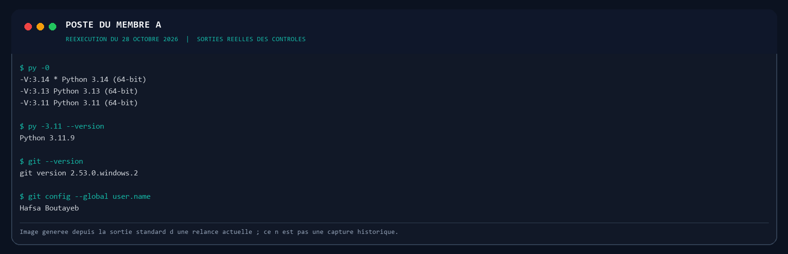
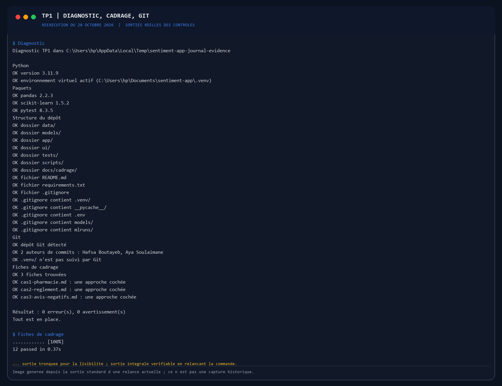
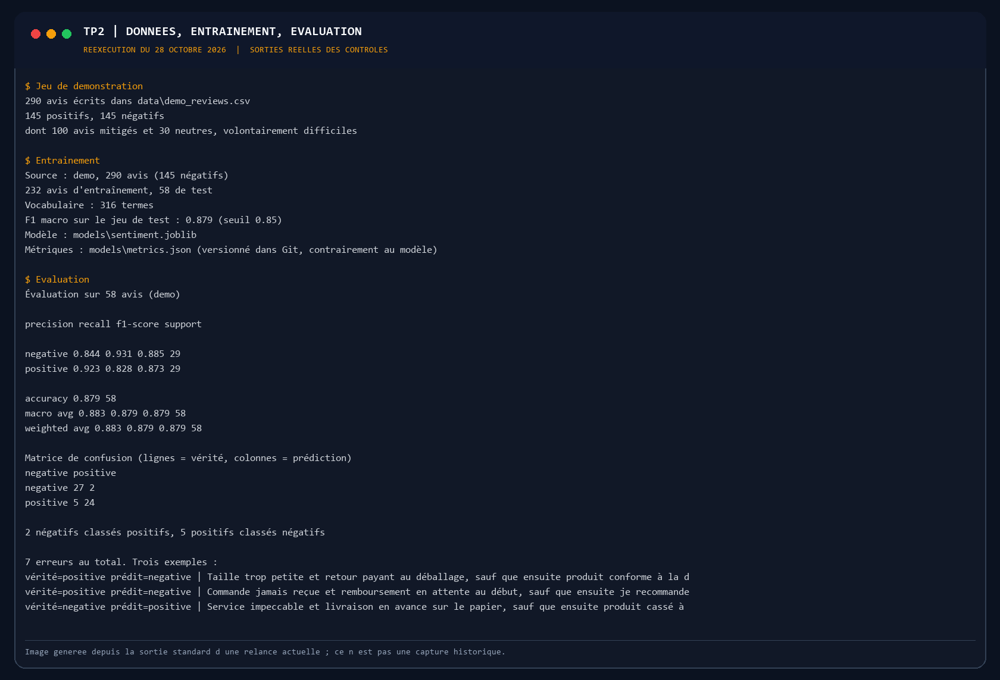
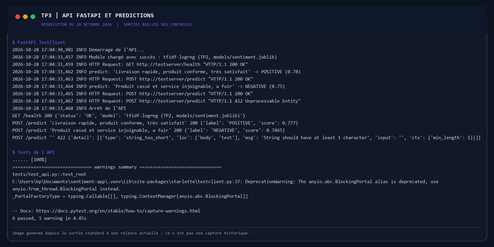
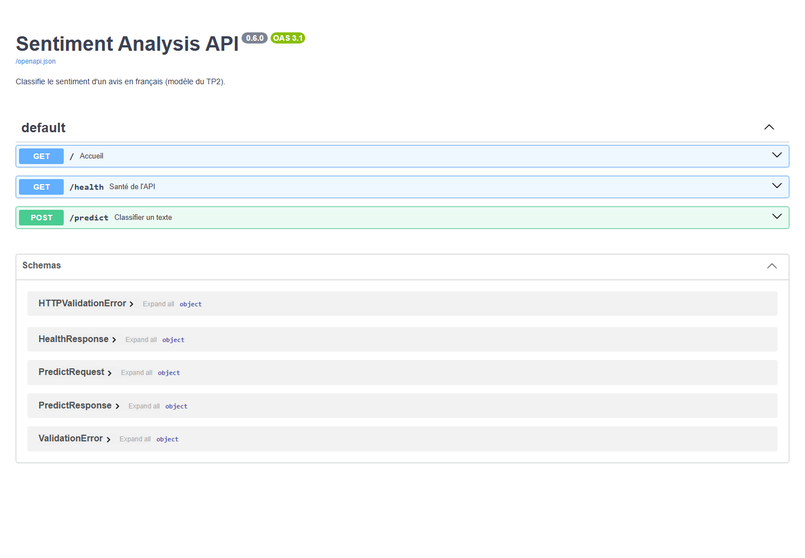
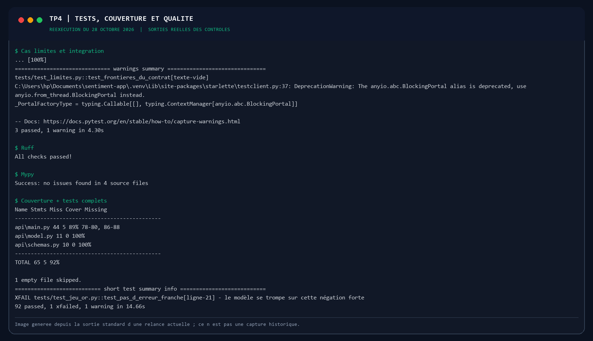
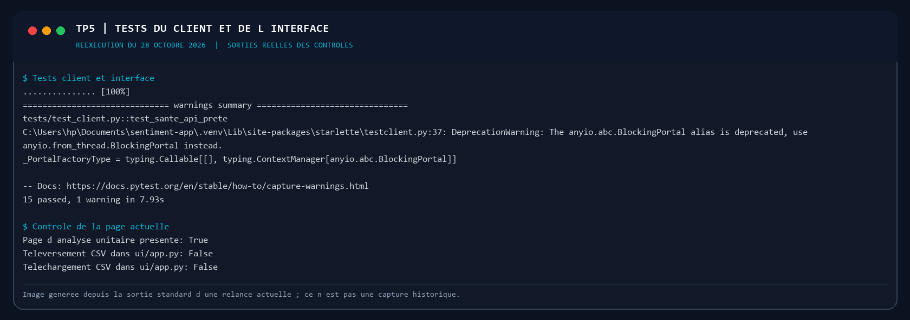
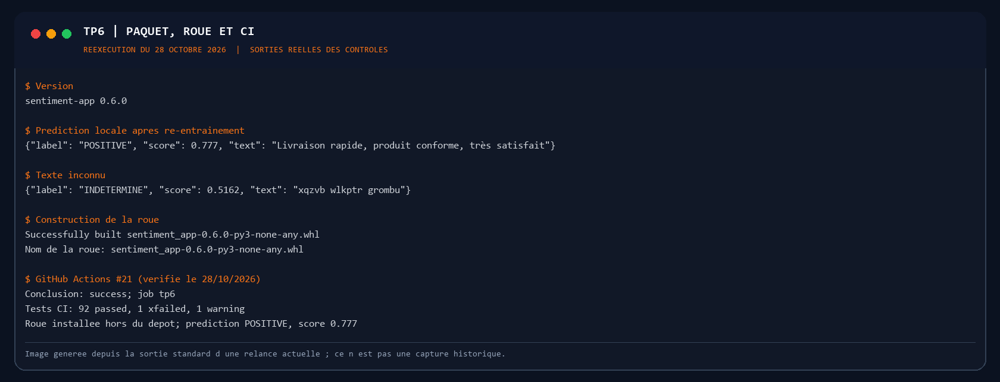

# Journal de bord du binôme : TP1 à TP6

**Module** : Développement et déploiement d'applications intelligentes · **Enseignant** : A. Larhlimi

|  | Membre A | Membre B |
| :---- | :---- | :---- |
| Nom | Hafsa Boutayeb | Aya Soulaimane |
| Compte GitHub | @hafsaboutayeb5-png | @ayasoulaimane |

**Dépôt** : https://github.com/hafsaboutayeb/sentiment-app

> **État des preuves :** le membre A est Hafsa Boutayeb et le membre B est Aya Soulaimane. Les captures des séances historiques ne sont pas disponibles ; ne pas les recréer en les présentant comme anciennes. Les images `reprise-tp*.png` sont des sorties de contrôles réellement relancés le 28 octobre 2026, dans un worktree isolé, et non des captures des séances initiales. L'image FastAPI montre l'interface Swagger réellement ouverte pendant cette reprise. Le poste d'Aya n'est pas accessible depuis ce journal ; ses contrôles restent à vérifier sur son ordinateur. Les cases restent décochées lorsqu'une preuve manque.

## Comment remplir ce journal

Ce fichier se place dans votre dépôt, sous `docs/journal-tp1-tp6.md`, et vos captures d'écran dans `docs/captures/`. Créez ce dossier une fois :

```powershell
New-Item -ItemType Directory -Force docs\captures
```

&nbsp;

Après chaque contrôle, remplissez les quatre rubriques de son bloc :

1. **Obtenu** : remplacez la proposition de référence par les lignes utiles de votre sortie réelle (la dernière ligne de pytest, le message affiché), pas tout le terminal.  
2. **Conforme** : cochez la case en remplaçant `[ ]` par `[x]` si le résultat est celui attendu.  
3. **Commentaire** : deux ou trois phrases. Ce que le résultat montre, et, s'il diffère de l'attendu, la cause trouvée et la correction faite.  
4. **Capture** : distinguez une capture de séance originale d'une reprise récente. Les images datées au début de chaque TP sont des preuves de relance au 28 octobre 2026 ; elles ne prouvent pas qu'une étape intermédiaire a été exécutée à l'époque.

**Faire une capture originale sous Windows** : `Windows + Maj + S`, sélectionnez la zone utile, puis enregistrez-la au format PNG dans `docs/captures/`. Pour les contrôles d'Aya, elle doit prendre les captures sur son propre ordinateur. Ne présentez pas une réexécution actuelle comme une image historique.

**Ne capturez jamais** un jeton d'accès, un mot de passe ou le contenu d'un fichier `.env`.

À la fin de chaque TP, commitez le journal et les captures :

```powershell
git add docs/journal-tp1-tp6.md docs/captures
git commit -m "Ajouter le journal global des TP1 a TP6"
git push
```

&nbsp;

---

## 0\. La préparation des postes

### Poste du membre A



```powershell
py -0
py -3.11 --version
git --version
git config --global user.name
```

&nbsp;

**Attendu (guide de référence, à vérifier)** : une version 3.11 dans la liste, `Python 3.11.x`, une version de Git, le nom du membre A.

**Obtenu (vérifié sur le poste A disponible)** :

```text
Python 3.11.9
Git version 2.53.0.windows.2
git config --global user.name : Hafsa Boutayeb
py -0 : Python 3.11, 3.13 et 3.14 installés
```

- [x] Conforme

**Commentaire** :

> Python 3.11 est disponible et le nom Git configuré correspond à Hafsa Boutayeb. La capture du terminal reste à ajouter.


### Poste du membre B

```powershell
py -0
py -3.11 --version
git --version
git config --global user.name
```

&nbsp;

**Attendu (guide de référence, à vérifier)** : une version 3.11, `Python 3.11.x`, une version de Git, le nom du membre B, différent de celui du membre A.

**Obtenu** :

```text
Non vérifié : le poste de la membre B n'est pas accessible depuis cette session.
```

- [ ] Conforme

**Commentaire** :

> Réponse de référence à adapter : comparer les versions obtenues à Python 3.11 et vérifier que le `user.name` correspond au membre B et diffère de celui du membre A.


---

## TP1 : cadrer l'application et préparer l'environnement



### T0 · La structure du kit (membre A)

```powershell
Get-ChildItem -Force
```

&nbsp;

**Attendu (guide de référence, à vérifier)** : les sept dossiers `app`, `data`, `docs`, `models`, `scripts`, `tests`, `ui`, ainsi que `.github` et `.gitignore`.

**Obtenu (référence à vérifier localement)** :

```text
Dossiers attendus : app, data, docs, models, scripts, tests, ui, .github
Fichier attendu : .gitignore
```

- [ ] Conforme

**Commentaire** :

> La structure separe clairement application, donnees, documentation, modeles, scripts, tests et interface.


### T1 · L'environnement et le point de départ (membre A)

```powershell
py -3.11 -m venv .venv
.venv\Scripts\Activate.ps1
python --version
pip install -r requirements.txt
python -m pip freeze | Out-File -Encoding utf8 requirements.lock
python scripts/check_setup.py
python -m pytest -q
```

&nbsp;

**Attendu (guide de référence, à vérifier)** : `Python 3.11.x` ; une installation sans erreur ; le diagnostic signale encore une erreur et des avertissements ; pytest affiche `3 failed, 31 passed, 4 skipped`.

**Obtenu (référence à vérifier localement)** :

```text
Python 3.11.x
Diagnostic : une erreur et des avertissements (details a relever)
pytest : 3 failed, 31 passed, 4 skipped
```

- [ ] Conforme

**Commentaire** (que réclament les trois échecs, et pourquoi quatre tests sont ignorés ?) :

> Les trois echecs de depart reclament les fiches de cadrage encore vides. Les quatre tests ignores attendent que le depot Git existe.


### T2 · Les fiches de cadrage (à deux)

```powershell
python -m pytest tests/test_cadrage.py -q
python -m pytest -q
```

&nbsp;

**Attendu (guide de référence, à vérifier)** : `12 passed`, puis `34 passed, 4 skipped`.

**Obtenu (référence à vérifier localement)** :

```text
pytest tests/test_cadrage.py -q : 12 passed
pytest -q : 34 passed, 4 skipped
```

- [ ] Conforme

**Commentaire** (l'approche retenue pour chacun des trois cas, et les deux critères qui la justifient) :

> Cas 1 : regles metier pour verifier les champs obligatoires d une ordonnance; cas 2 : RAG pour citer le reglement; cas 3 : apprentissage supervise pour classer les avis. Les justifications s appuient notamment sur donnees etiquetees, verificabilite et consequence d une erreur.


### T3 · Le dépôt GitHub et le premier push (membre A)

```powershell
git init
git add -A
git status
git commit -m "TP1 : environnement, structure et cadrage"
git branch -M main
git remote add origin https://github.com/hafsaboutayeb/sentiment-app.git
git push -u origin main
python -m pytest -q
```

&nbsp;

**Attendu (guide de référence, à vérifier)** : `git status` ne liste ni `.venv/`, ni `.env`, ni fichier `.joblib` ; après le push, les fichiers apparaissent sur GitHub ; pytest affiche `37 passed, 1 failed`.

**Obtenu (référence à vérifier localement)** :

```text
git status : aucun .venv/, .env ou fichier .joblib suivi
Push : fichiers visibles sur GitHub
pytest : 37 passed, 1 failed (historique a deux auteurs incomplet a ce stade)
```

- [ ] Conforme

**Commentaire** (quel test échoue encore, et pourquoi ?) :

> Le test encore en echec est celui de l historique Git : un seul auteur a contribue pour l instant. C est attendu avant le commit du membre B.


### T4 · L'environnement du membre B (membre B)

```powershell
git clone https://github.com/hafsaboutayeb/sentiment-app.git sentiment-app
cd sentiment-app
py -3.11 -m venv .venv
.venv\Scripts\Activate.ps1
pip install -r requirements.txt
python scripts/check_setup.py
```

&nbsp;

**Attendu (guide de référence, à vérifier)** : `0 erreur(s)` au diagnostic.

**Obtenu (référence à vérifier localement)** :

```text
check_setup.py : 0 erreur(s)
```

- [ ] Conforme

**Commentaire** :

> Le diagnostic confirme que le clone du membre B dispose des fichiers et dependances requis. Le fichier requirements.lock peut varier entre postes et ne doit pas etre remplace par le membre B.


### T5 · Un commit par membre (membres B puis A)

```powershell
git pull
git add README.md
git commit -m "README : ajout de <nom> au tableau du binome"
git push
git shortlog -sn --all
python -m pytest tests/test_git_history.py -q
```

&nbsp;

**Attendu (guide de référence, à vérifier)** : deux noms distincts dans `git shortlog`, puis `3 passed`.

**Obtenu (référence à vérifier localement)** :

```text
git shortlog : deux auteurs distincts
pytest tests/test_git_history.py -q : 3 passed
```

- [ ] Conforme

**Commentaire** :

> L historique doit montrer deux auteurs distincts; les trois tests valident que l historique Git contient les contributions requises.


### T6 · La vérification finale (à deux)

```powershell
git pull
python scripts/check_setup.py
python -m pytest -q
```

&nbsp;

**Attendu (guide de référence, à vérifier)** : `0 erreur(s), 0 avertissement(s)`, puis `38 passed` ; l'onglet Actions est vert.

**Obtenu (référence à vérifier localement)** :

```text
check_setup.py : 0 erreur(s), 0 avertissement(s)
pytest : 38 passed
GitHub Actions : vert
```

- [ ] Conforme

**Commentaire** :

> Le controle final verifie ensemble diagnostic, tests et CI apres les contributions des deux membres.


### T7 · Le clone frais

```powershell
cd $env:TEMP
git clone https://github.com/hafsaboutayeb/sentiment-app.git verif
cd verif
py -3.11 -m venv .venv
.venv\Scripts\Activate.ps1
pip install -r requirements.txt
python scripts/check_setup.py
python -m pytest -q
```

&nbsp;

**Attendu (guide de référence, à vérifier)** : `0 erreur(s)` et `38 passed`, sans aucune intervention.

**Obtenu (référence à vérifier localement)** :

```text
Clone frais : 0 erreur(s)
pytest : 38 passed
```

- [ ] Conforme

**Commentaire** (qu'est-ce que ce contrôle prouve que T6 ne prouvait pas ?) :

> Le clone frais verifie que l installation fonctionne dans un dossier neuf, sans reutiliser les environnements ou fichiers locaux des postes du binome.


---

## TP2 : entraîner, évaluer et sauvegarder le modèle



### C1 · Le kit installé (membre A)

```powershell
python C:\IA-DEV\tp2-semaine2\appliquer_tp2.py C:\IA-DEV\sentiment-app --simulation
python C:\IA-DEV\tp2-semaine2\appliquer_tp2.py C:\IA-DEV\sentiment-app
python -m pytest -q
```

&nbsp;

**Attendu (guide de référence, à vérifier)** : la simulation liste les fichiers du kit et l'ajout de `!models/metrics.json` au `.gitignore` ; pytest affiche `2 failed, 38 passed, 2 skipped`.

**Obtenu (référence à vérifier localement)** :

```text
Simulation : fichiers du kit listes, ajout de !models/metrics.json au .gitignore
pytest : 2 failed, 38 passed, 2 skipped (echecs initiaux attendus)
```

- [ ] Conforme

**Commentaire** (que réclament les deux échecs ?) :

> Les deux echecs de reference correspondent a predict() et aux tests du modele, qui ne sont pas encore ajoutes au debut du TP2.


### C2 · Le jeu de démonstration

```powershell
python src/make_demo.py
```

&nbsp;

**Attendu (guide de référence, à vérifier)** : `290 avis écrits`, 145 positifs et 145 négatifs.

**Obtenu (référence à vérifier localement)** :

```text
290 avis ecrits dans data/demo_reviews.csv
145 positifs, 145 negatifs
100 avis mitiges et 30 neutres
```

- [ ] Conforme

**Commentaire** (recopiez un avis mitigé et expliquez sa structure) :

> Exemple déterministe du générateur : « Je recommande sans hésiter au déballage, jusqu'à ce que commande jamais reçue et remboursement en attente. » L'étiquette est négative car la dernière partie de l'avis retourne le sentiment. Vérifier la citation dans `data/demo_reviews.csv` après génération.


### C3 · L'entraînement

```powershell
python src/train.py
git status --short
```

&nbsp;

**Attendu (guide de référence, à vérifier)** : `Vocabulaire : 316 termes`, `F1 macro sur le jeu de test : 0.879 (seuil 0.85)` ; dans `git status`, `models/metrics.json` apparaît, ni `models/sentiment.joblib` ni `data/demo_reviews.csv`.

**Obtenu (référence à vérifier localement)** :

```text
Vocabulaire : 316 termes
F1 macro sur le jeu de test : 0.879 (seuil 0.85)
git status --short : models/metrics.json; pas de models/sentiment.joblib ni data/demo_reviews.csv
```

- [ ] Conforme

**Commentaire** (pourquoi la mesure est-elle versionnée, et pas le modèle ?) :

> Les metriques sont de petits resultats textuels utiles pour suivre les executions. Le modele joblib est lourd, regenerable et lie aux donnees et aux bibliotheques; il est donc exclu de Git.


### C4 · L'évaluation

```powershell
python src/evaluate.py
```

&nbsp;

**Attendu (guide de référence, à vérifier)** : la matrice `27 2` sur la ligne `negative`, `5 24` sur la ligne `positive` ; 7 erreurs sur 58 avis.

**Obtenu (référence à vérifier localement)** :

```text
Matrice : negative [27, 2] ; positive [5, 24]
7 erreurs sur 58 avis; le guide indique qu elles concernent des avis mitiges
Exemples documentes dans l annexe B :
positive -> negative : Taille trop petite et retour payant au déballage, sauf que ensuite produit conforme à la description, très satisfait.
positive -> negative : Commande jamais reçue et remboursement en attente au début, sauf que ensuite je recommande sans hésiter.
negative -> positive : Service impeccable et livraison en avance sur le papier, sauf que ensuite produit cassé à l arrivée.
Verifier lesquels des exemples sont effectivement affiches par evaluate.py sur le poste.
```

- [ ] Conforme

**Commentaire** (pourquoi le modèle se trompe-t-il sur ces avis ?) :

> Le modele TF-IDF apprend des associations de mots, pas le contexte. Negation, ironie, formulations mixtes et exemples peu representes peuvent donc produire des erreurs.


### C5 · Le vrai jeu de données, les tests, le push

```powershell
python src/train.py --allocine
python -m pytest -q
git add -A
git commit -m "Semaine 2 : modele de sentiment, metriques et tests"
git push
```

&nbsp;

**Attendu (guide de référence, à vérifier)** : `Source : allocine, 20000 avis`, `F1 macro sur le jeu de test : 0.920`, puis `42 passed` ; l'onglet Actions est vert.

**Obtenu (état des preuves du dépôt)** :

```text
models/metrics.json : source demo, 290 avis, F1 macro 0.879.
Aucun résultat Allociné n'est enregistré dans les métriques versionnées.
L'exécution Allociné et sa sortie pytest ne sont pas confirmées par les éléments du dépôt.
```

- [ ] Conforme

**Commentaire** (pourquoi le F1 est-il meilleur sur Allociné ?) :

> Le journal ne présente pas le score indicatif d'Allociné comme une mesure effectuée : les métriques conservées correspondent au jeu de démonstration. La case reste décochée tant qu'une exécution Allociné vérifiable n'est pas disponible.


### Membre B, après le TP2

```powershell
git pull
python src/make_demo.py
python src/train.py
python -m pytest -q
```

&nbsp;

**Attendu (guide de référence, à vérifier)** : `42 passed`.

**Obtenu (référence à vérifier localement)** :

```text
pytest : 42 passed
```

- [ ] Conforme


> Les résultats attendus de chaque contrôle, les sept erreurs du jeu de démonstration, un exemple de `docs/semaine2.md` et la fin du TP2 (push, CI, part du membre B) sont détaillés dans l'**annexe B**, à la fin de ce journal. Le script d'entraînement, `src/train.py`, est expliqué pas à pas dans l'**annexe C**.

---

## TP3 : exposer le modèle par une API



### T14 · Le kit installé (membre A)

```powershell
python C:\IA-DEV\kit-tp3\appliquer_tp3.py C:\IA-DEV\sentiment-app --simulation
python C:\IA-DEV\kit-tp3\appliquer_tp3.py C:\IA-DEV\sentiment-app
pip install -r requirements.txt
python src/train.py
python -m pytest -q
```

&nbsp;

**Attendu (guide de référence, à vérifier)** : la simulation liste les fichiers copiés et les compléments de `pytest.ini` et de `ci.yml` ; pytest affiche `48 passed`.

**Obtenu (référence à vérifier localement)** :

```text
Kit TP3 applique; pytest : 48 passed
```

- [ ] Conforme

**Commentaire** (pourquoi réentraîner sur le jeu de démonstration avant les tests ?) :

> Les tests de l API ont besoin d un modele charge. Comme le modele n est pas versionne, l entrainement du jeu de demonstration doit etre reproduit avant les tests, notamment dans la CI.


### T15 · `/health`



```powershell
uvicorn api.main:app --reload
```

&nbsp;

Puis, dans `http://localhost:8000/docs` : `GET /health`, « Try it out », « Execute ».

**Attendu (guide de référence, à vérifier)** : `200`, `"status": "OK"`, `"model": "tfidf-logreg (TP2, models/sentiment.joblib)"`.

**Obtenu (référence à vérifier localement)** :

```text
GET /health : HTTP 200
{"status": "OK", "model": "tfidf-logreg (TP2, models/sentiment.joblib)"}
```

- [ ] Conforme

**Commentaire** :

> Cette route confirme que le serveur a demarre et que le modele a ete charge; elle expose aussi le nom du modele actif.


### T16 · Un avis positif

`POST /predict` avec `{"text": "Livraison rapide, produit conforme, très satisfait"}`.

**Attendu (guide de référence, à vérifier)** : `200`, `"label": "POSITIVE"`, `"score": 0.777`.

**Obtenu (référence à vérifier localement)** :

```text
POST /predict : HTTP 200
{"label": "POSITIVE", "score": 0.777, "text": "Livraison rapide, produit conforme, tr?s satisfait"}
```

- [ ] Conforme

**Commentaire** :

> La reponse expose l etiquette positive et le score du modele. 0.777 est un score de confiance du classifieur, pas une certitude humaine.


Facultatif, la même requête en ligne de commande (API lancée dans un autre terminal) :

```powershell
python -c "import httpx; r = httpx.post('http://127.0.0.1:8000/predict', json={'text': 'Livraison rapide, produit conforme, très satisfait'}); print(r.status_code, r.json())"
```

&nbsp;

### T17 · Un avis négatif

`POST /predict` avec `{"text": "Produit cassé et service injoignable, à fuir"}`.

**Attendu (guide de référence, à vérifier)** : `200`, `"label": "NEGATIVE"`, `"score": 0.7465`.

**Obtenu (référence à vérifier localement)** :

```text
POST /predict : HTTP 200
{"label": "NEGATIVE", "score": 0.7465, "text": "Produit cass? et service injoignable, ? fuir"}
```

- [ ] Conforme

**Commentaire** :

> La reponse expose l etiquette negative et son score dans le format prevu par le contrat de l API.


### T18 · Les refus

`POST /predict` avec `{"text": ""}`, puis `{}`, puis `{"text": 42}`.

**Attendu (guide de référence, à vérifier)** : `422` dans les trois cas.

**Obtenu (référence à vérifier localement)** :

```text
{"text": ""} -> 422, string_too_short, loc ["body", "text"]
{} -> 422, missing, loc ["body", "text"]
{"text": 42} -> 422, string_type, loc ["body", "text"]
```

- [ ] Conforme

**Commentaire** (que dit `detail`, et pourquoi 422 plutôt que 500 ?) :

> Pydantic rejette les donnees invalides avant la prediction et renvoie un 422 avec le detail des erreurs. Un 500 signalerait plutot une panne interne.


### T19 · La CI

```powershell
git add -A
git commit -m "Semaine 3 : API FastAPI"
git push
```

&nbsp;

**Attendu (guide de référence, à vérifier)** : dans l'onglet Actions, l'étape « Modèle de démonstration, pour les tests de l'API (TP3) » passe, puis l'étape « Tests » affiche `48 passed`.

**Obtenu (référence à vérifier localement)** :

```text
GitHub Actions : etape modele de demonstration reussie; Tests : 48 passed
```

- [ ] Conforme

**Commentaire** (pourquoi la CI doit-elle entraîner le modèle ?) :

> La CI doit entrainer le modele avant les tests, car le fichier joblib est ignore par Git. Sans cette etape, les tests de l API n ont pas de modele.


### T20 · L'API sans modèle

```powershell
Rename-Item models/sentiment.joblib sentiment.bak
uvicorn api.main:app
Rename-Item models/sentiment.bak sentiment.joblib
```

&nbsp;

**Attendu (guide de référence, à vérifier)** : `FileNotFoundError: models/sentiment.joblib absent : lancez python src/train.py`, puis `Application startup failed`.

**Obtenu (référence à vérifier localement)** :

```text
FileNotFoundError: models/sentiment.joblib absent : lancez python src/train.py
Application startup failed
```

- [ ] Conforme

**Commentaire** :

> Sans le modele, le demarrage doit echouer explicitement plutot que de laisser l API accepter des requetes impossibles a traiter.


### Membre B, après le TP3

```powershell
git pull
python src/make_demo.py
python src/train.py
python -m pytest -q
```

&nbsp;

**Attendu (guide de référence, à vérifier)** : `48 passed`.

**Obtenu (référence à vérifier localement)** :

```text
pytest : 48 passed
```

- [ ] Conforme


> Les contrôles T15 à T20 sont expliqués en détail dans l'**annexe D**, à la fin de ce journal : ce qui se passe dans l'API à chaque essai, les réponses exactes attendues, et pourquoi. La structure de la page `/docs` et une liste de vingt essais à y faire sont dans l'**annexe E**.

---

## TP4 : tests approfondis et qualité



### T21 · Le kit installé et le point de départ (membre A)

```powershell
python C:\IA-DEV\tp4-tests-qualite\appliquer_tp4.py C:\IA-DEV\sentiment-app
pip install -r requirements-dev.txt
python src/train.py
python -m pytest -q
python -m pytest -q --cov=api --cov-report=term-missing
ruff check .
mypy api
```

&nbsp;

**Attendu (guide de référence, à vérifier)** : `1 failed, 51 passed, 1 skipped` ; couverture de `api/` à 91 % ; quelques remarques de ruff ; mypy `Success: no issues found in 4 source files`.

**Obtenu (référence à vérifier localement)** :

```text
pytest : 1 failed, 51 passed, 1 skipped (test_jeu_or_complet)
Couverture api : 91 %
ruff : 11 remarques selon le guide; docs/semaine4.md du dépôt indique environ 15 au départ
mypy : Success: no issues found in 4 source files
```

- [ ] Conforme

**Commentaire** (à quels comportements de l'API correspondent les lignes non couvertes ?) :

> Le point de depart laisse non couvertes des lignes des chemins d erreur et de demarrage. Ruff signale 11 remarques; mypy ne voit pas encore le type precis du retour de predict().


### T22 · Le contrat d'entrée corrigé

Avant la correction du schéma :

```powershell
python -m pytest -q tests/test_limites.py
```

&nbsp;

**Attendu avant correction (guide de référence, à vérifier)** : `2 failed, 8 passed`, et un contre-exemple d'hypothesis sous « Falsifying example ».

**Obtenu (référence à vérifier localement)** :

```text
pytest : 2 failed, 8 passed
Falsifying example : texte = \x85 (U+0085)
```

Après la correction, dans `/docs` : `POST /predict` avec `{"text": "   "}`.

**Attendu après correction** : `422`, avec un `detail` en liste, comme pour `{"text": ""}`.

**Obtenu (référence à vérifier localement)** :

```
POST /predict avec trois espaces : HTTP 422
detail : liste d erreurs de validation, comme pour le texte vide
```

- [ ] Conforme

**Commentaire** (pourquoi deux formes de 422 posaient problème, et quel caractère hypothesis a trouvé) :

> Les espaces pouvaient produire un 422 sous une autre forme. Hypothesis trouve le plus petit contre-exemple avec le caractere Unicode U+0085 (\x85), retire par strip(); le validateur doit aligner le schema et predict().


### T23 · Les propriétés

```powershell
python -m pytest -q tests/test_limites.py
python -m pytest -q tests/test_limites.py
python -m pytest -q tests/test_limites.py
```

&nbsp;

**Attendu (guide de référence, à vérifier)** : `10 passed`, trois fois de suite.

**Obtenu (référence à vérifier localement)** :

```text
pytest tests/test_limites.py -q : 10 passed lors de chacune des trois executions
```

- [ ] Conforme

**Commentaire** :

> Les executions successives verifient que les tests bases sur des proprietes restent reproductibles.


### T24 · L'abstention

```powershell
python src/courbe_seuil.py
```

&nbsp;

**Attendu (guide de référence, à vérifier)** : la première ligne `0.50  58  100%  0.879  7  0`. Attention : le guide indique un seuil de 0.60, tandis que le compte rendu déjà présent dans le dépôt (`docs/semaine4.md`) indique un seuil retenu de 0.65 et environ 15 % d'avis envoyés à un humain. Vérifier la version effectivement exécutée avant de choisir la valeur à reporter. Dans `/docs`, un texte fait de mots inventés reçoit `INDETERMINE`.

**Obtenu (référence à vérifier localement)** :

```text
seuil | repond | part exacte | exactitude | erreurs | vers humain
0.50 | 58 | 100% | 0.879 | 7 | 0
Version du guide : seuil 0.60. Compte rendu du dépôt : seuil retenu 0.65, environ 15 % envoyés à un humain.
Texte invente : INDETERMINE (score exact a relever)
```

- [ ] Conforme

**Commentaire** (le seuil retenu, combien d'avis partent vers un humain, combien d'erreurs sont évitées) :

> Le seuil d'abstention empêche de forcer une classe lorsque le score est trop faible. Le guide de rattrapage donne 0.60, mais `docs/semaine4.md` dans le dépôt annonce 0.65 et environ 15 % d'avis envoyés à un humain : il faut retenir la valeur réellement présente dans le code et observée dans la sortie.


### T25 · Le jeu d'or

```powershell
python src/bilan_jeu_or.py
python -m pytest -q tests/test_jeu_or.py
```

&nbsp;

**Attendu (guide de référence, à vérifier)** : le bilan des 20 avis ; aucun `failed`, les erreurs déclarées en `xfailed`.

**Obtenu (référence à vérifier localement)** :

```text
Bilan de reference de docs/semaine4.md : justes 14, abstentions 0, erreurs franches declarees 6 sur 20 avis
pytest tests/test_jeu_or.py : aucun failed; erreurs connues declarees xfailed
```

- [ ] Conforme

**Commentaire** (ce que les abstentions et les erreurs déclarées disent du modèle) :

> Les abstentions montrent que le modele peut signaler son incertitude. Les erreurs connues restent dans le jeu d or et sont declarees xfailed au lieu d etre masquees.


### T26 · L'intégration et la couverture

```powershell
python -m pytest -q tests/test_integration.py
python -m pytest -q --cov=api --cov-report=term-missing --cov-fail-under=95
```

&nbsp;

**Attendu (guide de référence, à vérifier)** : avant la correction de `main.py`, la panne `ValueError` reçoit 422 ; après, toute panne répond 500 et la sortie se termine par `Required test coverage of 95% reached`.

**Obtenu (référence à vérifier localement)** :

```text
Avant correction : une ValueError etait convertie a tort en HTTP 422
Apres correction : panne interne -> HTTP 500
Couverture : seuil 95 % atteint (guide : 97 % sans exclusion; 100 % avec __main__ exclu)
```

- [ ] Conforme

**Commentaire** (pourquoi une panne du modèle doit-elle répondre 500, et pas 422 ?) :

> Une entree invalide releve du client (422); une panne du modele releve du serveur (500). Un 422 attribuerait a tort la panne a l utilisateur.


### T27 · Qualité statique, crochet et CI

```powershell
mypy api
ruff check .
python -m pytest -q
pre-commit install
```

&nbsp;

**Attendu (guide de référence, à vérifier)** : mypy signale `.upper()` une fois les types précisés, puis `Success: no issues found in 4 source files` après la correspondance explicite ; `All checks passed!` ; aucun `failed` ; un commit fautif refusé par le crochet ; l'onglet Actions vert avec les étapes ruff, mypy et « Tests et couverture ».

**Obtenu (référence à vérifier localement)** :

```text
Avant correction : mypy signale l usage de .upper() avec le type precise
Final : ruff All checks passed! ; mypy Success: no issues found in 4 source files
pytest : 83 passed, 2 xfailed, aucun failed; pre-commit et CI verts
```

- [ ] Conforme

**Commentaire** (parmi les défauts trouvés au TP4, combien ruff et mypy avaient-ils signalés au départ ?) :

> Au depart, Ruff signale 11 remarques et mypy aucune. Le typage plus precis revele ensuite que .upper() ne convient pas a toutes les etiquettes; une correspondance explicite traite chaque cas.


### Membre B, après le TP4

```powershell
git pull
pip install -r requirements-dev.txt
python src/train.py
pre-commit install
python -m pytest -q
```

&nbsp;

**Attendu (guide de référence, à vérifier)** : aucun `failed`.

**Obtenu (référence à vérifier localement)** :

```text
pytest : aucun failed (ligne exacte a relever)
```

- [ ] Conforme


> Ce que sont `ruff` et `mypy`, ce que chacun vérifie et pourquoi ils figurent dans la CI sont expliqués dans l'**annexe F**, à la fin de ce journal.

---

## TP5 : l'interface Streamlit



### T28 · Le kit installé (membre A)

```powershell
python C:\IA-DEV\tp5-interface\appliquer_tp5.py C:\IA-DEV\sentiment-app --simulation
python C:\IA-DEV\tp5-interface\appliquer_tp5.py C:\IA-DEV\sentiment-app
python src/train.py
python -m pytest -q
```

&nbsp;

**Attendu (guide de référence, à vérifier)** : la simulation liste `ui/`, les deux fichiers de tests, `data/avis_exemple.csv` et `docs/semaine5.md`, puis les compléments du `.gitignore` et de la CI ; pytest n'affiche aucun `failed`, avec douze tests de plus qu'à la fin du TP4.

**Obtenu (référence à vérifier localement)** :

```text
pytest : aucun failed; 12 tests supplementaires par rapport a la fin du TP4
Reference globale TP5 : 95 passed, 2 xfailed
```

- [ ] Conforme

**Commentaire** (que vérifient les tests du client, et ceux de la page ?) :

> Les tests du client verifient les appels HTTP, les reponses et les erreurs; ceux de la page verifient l affichage et les interactions Streamlit.


### T29 · La page ouverte, l'API prête

Deux terminaux, dans le dépôt :

```powershell
uvicorn api.main:app --reload
```

&nbsp;

```powershell
streamlit run ui/app.py
```

&nbsp;

**Attendu (guide de référence, à vérifier)** : la page s'ouvre sur `http://localhost:8501` et affiche `API prête : tfidf-logreg (TP2, models/sentiment.joblib)`.

**Obtenu (référence à vérifier localement)** :

```text
Streamlit ouvert sur http://localhost:8501
API prete : tfidf-logreg (TP2, models/sentiment.joblib)
```

- [ ] Conforme

**Commentaire** :

> La page depend de l API : le message API prete confirme que le serveur repond et que le modele est charge. Garder les processus dans deux terminaux.


### T30 · Les verdicts

Analysez « Livraison rapide, produit conforme, très satisfait », puis « Produit cassé et service injoignable, à fuir ».

**Attendu (guide de référence, à vérifier)** : Avis positif, 78 % ; puis Avis négatif, 75 %.

**Obtenu (référence à vérifier localement)** :

```text
Avis positif : 78 %
Avis negatif : 75 %
```

- [ ] Conforme

**Commentaire** (d'où viennent ces pourcentages ?) :

> Les pourcentages viennent des scores retournes par le modele puis arrondis par l interface; 78 % et 75 % sont les valeurs de reference.


### T31 · L'abstention

Analysez « xqzvb wlkptr grombu ».

**Attendu (guide de référence, à vérifier)** : « Je ne sais pas : à faire vérifier par un humain », 52 %, et le message sur le seuil d'abstention.

**Obtenu (référence à vérifier localement)** :

```text
Je ne sais pas : a faire verifier par un humain
Confiance : 52 %; message sur le seuil d abstention affiche
```

- [ ] Conforme

**Commentaire** (pourquoi cet affichage vaut-il mieux qu'un verdict forcé ?) :

> Le score est sous le seuil d abstention (0.65); l interface demande une verification humaine au lieu de presenter une classe incertaine comme un verdict.


### T32 · Les erreurs

Analysez trois espaces. Arrêtez ensuite l'API (`Ctrl+C` dans son terminal), rechargez la page, puis relancez l'API.

**Attendu (guide de référence, à vérifier)** : l'avertissement « Texte refusé » ; puis, l'API arrêtée, « API injoignable : lancez d'abord uvicorn api.main:app ».

**Obtenu (référence à vérifier localement)** :

```text
Trois espaces : Texte refuse : vide, fait d espaces, ou de plus de 2000 caracteres (HTTP 422)
API arretee : API injoignable : lancez d abord uvicorn api.main:app
```

- [ ] Conforme

**Commentaire** (quelle réponse de l'API se cache derrière chaque message ?) :

> Le texte compose d espaces est refuse par l API avec 422; quand le serveur est arrete, l appel echoue au niveau reseau et l interface affiche API injoignable.


### T33 · Un fichier d'avis

Onglet « Un fichier d'avis », fichier `data/avis_exemple.csv`, puis « Télécharger les résultats ».

**Attendu (guide de référence, à vérifier)** : un tableau de six avis ; le résumé `{'INDETERMINE': 1, 'NEGATIVE': 2, 'POSITIVE': 3}` ; un fichier `resultats.csv` téléchargé.

**Obtenu (état du dépôt)** :

```text
ui/app.py expose actuellement l'analyse d'un avis individuel.
Le téléversement CSV et le téléchargement resultats.csv ne sont pas proposés par la page.
ui/helpers.py contient des fonctions de traitement par lot, mais ce contrôle d'interface n'est pas réalisé.
```

- [ ] Conforme

**Commentaire** (combien d'avis partent vers un humain, et lesquels ?) :

> Le parcours CSV de l'énoncé n'est pas présent dans la page Streamlit actuelle ; les helpers de traitement par lot ne suffisent pas à valider un téléversement et un téléchargement depuis l'interface. Ce contrôle reste à réaliser après implémentation de cette fonctionnalité.


### T34 · Compte rendu, push, CI

```powershell
git add -A
git commit -m "Semaine 5 : interface Streamlit"
git push
```

&nbsp;

**Attendu (guide de référence, à vérifier)** : `docs/semaine5.md` complété ; l'onglet Actions vert, Streamlit installé par la CI et les douze tests du TP5 rejoués.

**Obtenu (référence à vérifier localement)** :

```text
docs/semaine5.md present dans le depot
GitHub Actions : run #15 réussi le 2026-10-21 (commit 5827684, finalisation TP5) — [voir le run](https://github.com/hafsaboutayeb/sentiment-app/actions/runs/39638076759)
Tests dans la CI : 86 passed, 1 xfailed, 1 warning (d'après la capture).
```

- [ ] Conforme

**Commentaire** :

> La CI installe Streamlit et rejoue les douze tests ajoutes au TP5; son statut doit etre verifie apres le push.


### Membre B, après le TP5

```powershell
git pull
python src/train.py
python -m pytest -q
streamlit run ui/app.py
```

&nbsp;

**Attendu (guide de référence, à vérifier)** : aucun `failed`, puis la page « API prête » une fois l'API lancée.

**Obtenu (référence à vérifier localement)** :

```text
pytest : aucun failed
Page Streamlit : API prete apres demarrage de l API
```

- [ ] Conforme


---

## TP6 : packager l'application



### T35 · Le kit installé (membre A)

```powershell
python C:\IA-DEV\tp6-packaging\appliquer_tp6.py C:\IA-DEV\sentiment-app
pip install -r requirements-dev.txt
python -m pytest -q
```

&nbsp;

**Attendu (guide de référence, à vérifier)** : 2 failed, voulus : `test_le_modele_se_place_ou_l_on_veut` et `test_l_api_ne_bricole_plus_le_chemin_de_python`

**Obtenu (étape intermédiaire non vérifiée)** :

```text
La sortie pytest de cette étape initiale n'est pas conservée.
La validation finale du TP6 est enregistrée en CI : 92 passed, 1 xfailed.
```

- [ ] Conforme

**Commentaire** (que réclame chacun des deux échecs ?) :

> Cette étape décrit l'état avant le déplacement du prédicteur et le branchement de l'API sur le paquet. Nous ne disposons pas de sa sortie pytest historique ; le résultat final est consigné au T41.


### T36 · predict.py dans le paquet

```powershell
git mv src/predict.py sentiment_app/predict.py
Copy-Item C:\IA-DEV\tp6-packaging\extraits\predict_compatibilite.py src\predict.py
python -m pytest -q
python src/predict.py "Livraison rapide, produit conforme, très satisfait"
```

&nbsp;

**Attendu (guide de référence, à vérifier)** : 1 failed ; `positive (confiance 78%)`

**Obtenu (étape intermédiaire non vérifiée)** :

```text
La sortie pytest et celle de la commande de cette étape ne sont pas conservées.
Dans l'état final, src/predict.py reste une couche de compatibilité et le paquet contient sentiment_app.predict.
```

- [ ] Conforme

**Commentaire** (à quoi sert le fichier de compatibilité ?) :

> La couche de compatibilité préserve les anciens imports, tandis que le code principal est fourni dans le paquet. La sortie intermédiaire de cette séance n'est pas archivée.


### T37 · L'API branchée sur le paquet

```powershell
python -m pytest -q
Select-String -Path api\*.py -Pattern "sys.path"
ruff check .
mypy api
```

&nbsp;

**Attendu (guide de référence, à vérifier)** : aucun failed ; `Select-String` ne trouve rien ; ruff et mypy muets

**Obtenu (état final du dépôt)** :

```text
api/model.py importe sentiment_app.predict ; le code final n'ajoute pas src à sys.path.
La CI du 28 octobre exécute les tests et le packaging avec succès.
Les sorties intermédiaires exactes de Select-String, Ruff et mypy ne sont pas archivées dans cette séance.
```

- [ ] Conforme

**Commentaire** (qu'est-ce qui a changé dans api/model.py ?) :

> L'API utilise maintenant l'import du paquet au lieu de modifier le chemin Python. Le résultat de fin de TP est contrôlé en CI ; la capture de cette étape reste à ajouter si elle a été prise.


### T38 · La commande sentiment

```powershell
pip install -e .
sentiment --version
sentiment predict "Livraison rapide, produit conforme, très satisfait"
sentiment predict "xqzvb wlkptr grombu"
sentiment serve
```

&nbsp;

**Attendu (guide de référence, à vérifier)** : `sentiment-app 0.6.0` ; `POSITIVE` 0.777 ; `INDETERMINE` 0.5162 ; `/health` répond `OK`

**Obtenu (résultats finaux enregistrés)** :

```text
Version du paquet : sentiment-app 0.6.0
Prédiction de démonstration vérifiée par la CI : {"label": "POSITIVE", "score": 0.777, "text": "Livraison rapide, produit conforme, très satisfait"}
Les sorties locales de --version, du texte inventé et de /health ne sont pas conservées pour cette séance.
```

- [ ] Conforme

**Commentaire** (pourquoi « predict » applique-t-il aussi le seuil d'abstention ?) :

> La commande `predict` appelle la fonction de prédiction du paquet ; elle partage donc la logique de seuil avec l'API. La sortie locale de chaque commande reste à ajouter si elle a été prise.


### T39 · La roue

```powershell
Remove-Item -Recurse -Force dist -ErrorAction SilentlyContinue
python -m build --wheel
```

&nbsp;

**Attendu (guide de référence, à vérifier)** : `sentiment_app-0.6.0-py3-none-any.whl`, avec `api`, `sentiment_app`, `ui` seulement

**Obtenu (CI du 28 octobre 2026)** :

```text
Successfully built sentiment_app-0.6.0-py3-none-any.whl
La roue a ensuite été installée dans un environnement séparé du dépôt.
```

- [ ] Conforme

**Commentaire** (pourquoi ni tests, ni données, ni modèle ?) :

> La roue regroupe le code installable et ses métadonnées. Les tests, les données et le modèle restent en dehors du paquet ; la CI vérifie une installation isolée.


### T40 · La roue hors du dépôt

```powershell
cd $env:TEMP
py -3.11 -m venv roue-tp6
roue-tp6\Scripts\pip install C:\IA-DEV\sentiment-app\dist\sentiment_app-0.6.0-py3-none-any.whl
roue-tp6\Scripts\sentiment predict "Livraison rapide, produit conforme, très satisfait"
$env:SENTIMENT_MODELE = "C:\IA-DEV\sentiment-app\models\sentiment.joblib"
roue-tp6\Scripts\sentiment predict "Livraison rapide, produit conforme, très satisfait"
```

&nbsp;

**Attendu (guide de référence, à vérifier)** : sans la variable : « modèle introuvable », code 1 ; avec : `POSITIVE` 0.777

**Obtenu (CI du 28 octobre 2026)** :

```text
La CI installe la roue hors du dépôt et utilise SENTIMENT_MODELE vers le modèle généré.
Résultat : {"label": "POSITIVE", "score": 0.777, "text": "Livraison rapide, produit conforme, très satisfait"}
Le test local sans SENTIMENT_MODELE n'est pas conservé dans les preuves de cette séance.
```

- [ ] Conforme

**Commentaire** (qu'a-t-il fallu fournir à la roue, et qu'a-t-elle installé seule ?) :

> Le modèle est fourni au déploiement via `SENTIMENT_MODELE`, et non embarqué dans la roue. La CI valide l'installation et la prédiction depuis un environnement distinct du dépôt.


### T41 · Version, étiquette, push

```powershell
git add -A
git commit -m "Semaine 6 : paquet installable, version 0.6.0"
git tag -a v0.6.0 -m "TP6 : paquet installable"
git push
git push origin v0.6.0
```

&nbsp;

**Attendu (guide de référence, à vérifier)** : CI verte, étape « Roue installée hors du dépôt (TP6) » comprise ; l'étiquette `v0.6.0` visible sur GitHub

**Obtenu (vérifié)** :

```text
GitHub Actions #21, commit dd43210 : succès, job tp6.
Tests : 92 passed, 1 xfailed, 1 warning.
Roue 0.6.0 construite et installée hors du dépôt ; prédiction POSITIVE, score 0.777.
Le tag v0.6.0 n'est pas présent dans la liste des tags du clone local.
```

- [ ] Conforme

**Commentaire** :

> Le run #21 confirme la réussite de la CI sur le commit `dd43210`. Le tag `v0.6.0` n'a pas été vérifié sur GitHub ; ne pas cocher cette étape complète avant de confirmer s'il doit être publié. [Voir le run GitHub Actions #21](https://github.com/hafsaboutayeb/sentiment-app/actions/runs/40725875682).


### Membre B, après le TP6

```powershell
git pull
pip install -e .
python -m pytest -q
sentiment --version
```

&nbsp;

**Attendu (guide de référence, à vérifier)** : aucun `failed`, puis `sentiment-app 0.6.0`.

**Obtenu** :

```text
Non vérifié : le poste de la membre B n'est pas accessible depuis cette session.
```

- [ ] Conforme


> Les commandes de ce TP, leurs notions préalables et les points d'attention (ordre de T36, paquet `build`) sont expliqués dans l'**annexe H**, à la fin de ce journal.

---

## Les difficultés rencontrées

Les incidents ci-dessous sont ceux qui sont documentés dans le dépôt et l'historique CI. Les anciens runs rouges restent des instantanés historiques : seuls les nouveaux runs peuvent être verts.

| TP | Commande | Message | Cause | Solution |
| :---- | :---- | :---- | :---- | :---- |
| TP1, CI #1 et #2 | Tests de cadrage | Échec des tests sur les fiches vides | Les fiches de cadrage n'étaient pas encore remplies | Compléter les trois fiches ; les anciens runs restent rouges dans l'historique |
| TP1, CI #8 | Test de l'historique Git | Le dépôt ne contenait pas encore les deux auteurs attendus | Le commit d'Aya n'était pas présent dans cet instantané | Ajouter sa contribution ; l'historique actuel contient les deux noms |
| TP6, CI #16 | `pytest -q` | `tests/test_client.py::test_lot_et_resume` échoue | Le monkeypatch d'une propriété dynamique de `app.state` n'était pas restauré correctement | Modifier directement l'état avec `monkeypatch.setitem(app.state._state, "classifier", None)` ; CI #17 et suivantes réussies |
| TP6, CI #18 et #19 | GitHub Actions | Le job CI portait encore le nom `tp1` | Le nom de job dans le workflow n'avait pas été mis à jour | Renommer le job `tp6` ; les runs #18, #19 et #21 sont réussis |

## La répartition du travail

| TP | Ce qu'a fait le membre A | Ce qu'a fait le membre B |
| :---- | :---- | :---- |
| TP1 à TP6 | L'historique Git attribue la majorité des commits à Hafsa Boutayeb. Il montre les évolutions du code, des tests, de la CI et des documents. | L'historique Git contient un commit d'Aya Soulaimane pour le tableau du binôme dans le README. |

Cette répartition décrit uniquement les auteurs enregistrés par Git ; elle ne permet pas de prouver les tâches faites ensemble ou hors ligne. Les membres doivent corriger la description si elle ne correspond pas à leur travail réel.

## Le bilan

**TP1** :

> Le TP1 a posé la structure du dépôt, le cadrage des trois cas d'usage et le travail collaboratif avec Git. Les runs historiques qui avaient échoué ne sont pas modifiés rétroactivement ; l'état courant se vérifie dans les nouvelles exécutions de CI.

**TP2** :

> Le TP2 a ajouté la génération du jeu de démonstration, l'entraînement TF-IDF/logistique et l'évaluation. Les métriques versionnées portent sur 290 avis de démonstration (F1 macro 0,879) ; aucun résultat Allociné n'est enregistré dans les métriques du dépôt.

**TP3** :

> Le TP3 expose la prédiction par une API FastAPI, avec contrôle de santé, validation des entrées et tests automatisés.

**TP4** :

> Le TP4 a renforcé les tests des limites et du jeu d'or, introduit l'abstention et intégré les contrôles de qualité et de CI.

**TP5** :

> Le TP5 ajoute le client API et l'interface Streamlit pour l'analyse unitaire, avec gestion des erreurs et abstention. Les fonctions de traitement par lot existent dans `ui/helpers.py`, mais le téléversement CSV n'est pas proposé par la page actuelle.

**TP6** :

> Le TP6 transforme le projet en paquet Python installable `0.6.0`, fournit la commande `sentiment` et permet de configurer le chemin du modèle. La CI #21 a construit puis installé la roue hors du dépôt, exécuté les tests (92 passed, 1 xfailed) et obtenu une prédiction POSITIVE. Les captures historiques et la présence du tag `v0.6.0` sur GitHub restent à vérifier.

---

## Annexe A : comprendre tests/test\_cadrage.py

Ce fichier contient les douze tests qui vérifient les trois fiches de cadrage du TP1 (contrôle T2). Pour l'afficher : `Get-Content tests\test_cadrage.py`. Il comprend deux constantes, deux fonctions outils, utilisées par les tests, et cinq tests, que pytest reconnaît parce que leur nom commence par `test_`.

### Les constantes

```py
REQUIRED_SECTIONS = [
    "Besoin en une phrase",
    "Utilisateur final",
    "Approche retenue",
    "Justification",
    "Données nécessaires",
    "Métrique de succès",
    "Conséquence d'une erreur",
    "Risques éthiques",
]
CRITERIA = ["(a)", "(b)", "(c)", "(d)"]
```

Les huit titres de rubrique attendus, et les quatre critères acceptés dans la justification : (a) données étiquetées, (b) vérifiabilité, (c) coût par requête, (d) conséquence d'une erreur. Elles sont en haut du fichier pour être lues sans chercher. Ne les modifiez pas pour faire passer un test : c'est précisément ce que la notation vérifie.

### Les deux fonctions outils

#### `fiches(cadrage_dir)`

```py
def fiches(cadrage_dir: Path):
    return sorted(cadrage_dir.glob("cas*.md"))
```

**Rôle :** donner la liste des fiches à contrôler.

- `cadrage_dir.glob("cas*.md")` cherche dans `docs/cadrage/` les fichiers dont le nom commence par `cas` et finit par `.md`.  
- `sorted(...)` les range par ordre alphabétique : `cas1-pharmacie.md`, `cas2-reglement.md`, `cas3-avis-negatifs.md`.

**Conséquences :**

- `TEMPLATE.md`, `EXEMPLE-corrige.md` et `BANQUE-DE-CAS.md` ne commencent pas par `cas` : ils ne sont jamais contrôlés.  
- Le tri explique pourquoi les erreurs apparaissent toujours d'abord sur `cas1`.

#### `section_body(text, title)`

```py
def section_body(text: str, title: str) -> str:
    pattern = re.compile(rf"^## {re.escape(title)}.*?$\n(.*?)(?=^## |\Z)", re.M | re.S)
    m = pattern.search(text)
    return m.group(1).strip() if m else ""
```

**Rôle :** extraire le texte d'une rubrique, c'est-à-dire tout ce qui se trouve entre son titre et le titre suivant.

L'expression régulière, morceau par morceau :

| Morceau | Ce qu'il reconnaît |
| :---- | :---- |
| `^##&nbsp;` | Une ligne qui commence par `##`  (un titre de niveau 2\) |
| `{re.escape(title)}` | Le titre exact. `re.escape` neutralise les caractères spéciaux, comme l'apostrophe de « Conséquence d'une erreur » |
| `.*?$` | La fin de la ligne de titre, quelle qu'elle soit : `## Justification (deux critères)` convient aussi |
| `\n` | Le saut de ligne qui termine le titre |
| `(.*?)` | **Ce qu'on capture** : le corps de la rubrique, le plus court possible |
| `(?=^## |\Z)` | La limite : on s'arrête juste avant le prochain `##`  en début de ligne, ou à la fin du fichier (`\Z`), sans les inclure |

Les deux options :

- `re.M` fait agir `^` et `$` au début et à la fin de **chaque ligne**, et non du texte entier ;  
- `re.S` permet au point de traverser les sauts de ligne, pour que le corps puisse tenir sur plusieurs lignes.

Ensuite, `m.group(1).strip()` renvoie le corps sans les espaces de début et de fin. Si le titre est absent, la fonction renvoie une chaîne vide.

**Un exemple.** Pour cette fiche :

```markdown
## Justification
> Citez au moins deux critères.
(a) Aucune donnée étiquetée n'existe. (d) Une erreur peut être grave.

## Données nécessaires
```

&nbsp;

`section_body(texte, "Justification")` renvoie les deux lignes situées entre les deux titres : la consigne et la phrase rédigée.

### Les cinq tests

#### `test_three_fiches_exist`

```py
def test_three_fiches_exist(cadrage_dir: Path):
    assert len(fiches(cadrage_dir)) >= 3, "trois fiches cas*.md attendues dans docs/cadrage/"
```

**Vérifie** qu'il y a au moins trois fiches. Le paramètre `cadrage_dir` est une **fixture** : pytest le fournit automatiquement à partir de `tests/conftest.py`, qui le fait pointer vers `docs/cadrage/`. Le texte après la virgule de l'`assert` est le message affiché en cas d'échec.

**Échoue si** une fiche a été supprimée ou renommée, par exemple `Cas1.md` avec une majuscule.

#### `test_sections_present_in_every_fiche` (8 tests)

```py
@pytest.mark.parametrize("title", REQUIRED_SECTIONS)
def test_sections_present_in_every_fiche(cadrage_dir: Path, title):
    for fiche in fiches(cadrage_dir):
        assert f"## {title}" in fiche.read_text(encoding="utf-8"), f"{fiche.name} : rubrique '{title}' absente"
```

**Vérifie** que chaque titre de rubrique figure dans chaque fiche.

- Le décorateur `@pytest.mark.parametrize` exécute la fonction **une fois par rubrique**, avec `title` qui prend tour à tour les huit valeurs de `REQUIRED_SECTIONS`. Une seule fonction donne donc huit tests, affichés par exemple `test_sections_present_in_every_fiche[Justification]`.  
- Pour chaque rubrique, la boucle parcourt les trois fiches et cherche le texte exact `## <titre>`.

**Échoue si** un titre a été modifié ou supprimé : `## justification` sans majuscule, ou `### Justification` avec trois dièses au lieu de deux, ne correspondent pas. Ces huit tests passent dès le départ, puisque les fiches du kit contiennent déjà les titres. Ils protègent la structure.

#### `test_sections_are_filled`

```py
def test_sections_are_filled(cadrage_dir: Path):
    empty = []
    for fiche in fiches(cadrage_dir):
        text = fiche.read_text(encoding="utf-8")
        for title in REQUIRED_SECTIONS:
            if title == "Approche retenue":
                continue
            body = section_body(text, title)
            body = "\n".join(
                l for l in body.splitlines() if l.strip() and not l.startswith(">") and not l.startswith("- [")
            )
            if len(body) < 20:
                empty.append(f"{fiche.name} / {title}")
    assert not empty, "rubriques vides ou trop courtes : " + ", ".join(empty)
```

**Vérifie** que chaque rubrique contient au moins 20 caractères **rédigés par le binôme**.

1. Pour chaque fiche et chaque rubrique, sauf « Approche retenue » qui ne contient que des cases à cocher, la fonction extrait le corps avec `section_body`.  
2. Elle retire trois sortes de lignes :  
   - les lignes vides (`l.strip()` est faux) ;  
   - les consignes du modèle, qui commencent par `>` ;  
   - les cases à cocher, qui commencent par `- [`.  
3. Elle mesure ce qui reste. Sous 20 caractères, la rubrique est notée dans la liste `empty`.  
4. L'`assert` final échoue si la liste n'est pas vide.

Contrairement aux autres tests, celui-ci **rassemble toutes les rubriques trop courtes** avant d'échouer : son message les liste toutes, sous la forme `cas1-pharmacie.md / Besoin en une phrase, cas1-pharmacie.md / Justification, ...`.

**Une subtilité :** `startswith(">")` teste le début exact de la ligne. Une consigne précédée d'espaces, comme   `> texte`, n'est donc pas retirée.

#### `test_exactly_one_approach_checked`

```py
def test_exactly_one_approach_checked(cadrage_dir: Path):
    for fiche in fiches(cadrage_dir):
        text = fiche.read_text(encoding="utf-8")
        assert text.count("- [x]") == 1, f"{fiche.name} : cocher exactement une approche"
```

**Vérifie** qu'une seule approche est cochée par fiche. `text.count("- [x]")` compte les occurrences exactes de `- [x]` **dans tout le fichier**, et le test exige exactement 1\.

**Échoue si :**

- aucune case n'est cochée, comme dans les fiches du kit : le compte vaut 0 ;  
- deux cases sont cochées : le compte vaut 2 ;  
- la case est écrite autrement : `- [X]` avec un X majuscule, `-[x]` sans espace, ou `[x]` sans tiret ne comptent pas.

La boucle s'arrête à la **première fiche fautive**, dès qu'un `assert` échoue.

#### `test_justification_cites_two_criteria`

```py
def test_justification_cites_two_criteria(cadrage_dir: Path):
    for fiche in fiches(cadrage_dir):
        body = section_body(fiche.read_text(encoding="utf-8"), "Justification")
        cited = [c for c in CRITERIA if c in body]
        assert len(cited) >= 2, f"{fiche.name} : la justification doit citer au moins deux critères (a), (b), (c), (d)"
```

**Vérifie** que la justification s'appuie sur au moins deux critères.

1. La fonction extrait le corps de la rubrique « Justification ».  
2. La liste `cited` garde, parmi `(a)`, `(b)`, `(c)` et `(d)`, ceux qui apparaissent dans ce corps.  
3. Il en faut au moins deux.

**Échoue si :**

- les critères sont cités ailleurs que sous « Justification » ;  
- ils sont écrits autrement : `a)` sans parenthèse ouvrante, ou `(A)` en majuscule, ne comptent pas.

Ici, les consignes ne sont **pas retirées** du corps : une consigne qui contiendrait « (a) » compterait. C'est aussi un test qui s'arrête à la première fiche fautive.

Le test ne vérifie que la **présence** des lettres. Que les critères cités s'appliquent vraiment au cas, c'est l'enseignant qui le juge à la lecture : la grille du TP1 y consacre 4 points sur 10\.

### Lancer ces tests seuls

```powershell
python -m pytest tests/test_cadrage.py -q
python -m pytest tests/test_cadrage.py -v
```

&nbsp;

La première commande affiche un caractère par test (`.` réussi, `F` échoué, `s` ignoré), puis une ligne de bilan : `12 passed` quand les trois fiches sont complètes. La seconde affiche le nom de chaque test et son résultat.

---

## Annexe B : le TP2 en détail

Les valeurs ci-dessous ont été mesurées sur le jeu de démonstration, avec la graine fixée du kit : vous devez obtenir exactement les mêmes.

### Les résultats attendus, contrôle par contrôle

| Contrôle | Commande | Résultat attendu |
| :---- | :---- | :---- |
| C1 | `python -m pytest -q`, juste après `appliquer_tp2.py` | 2 failed, 38 passed, 2 skipped : les deux échecs réclament `models/metrics.json`, les deux tests ignorés attendent le modèle |
| C2 | `python src/make_demo.py` | `290 avis écrits`, 145 positifs et 145 négatifs, dont 100 mitigés et 30 neutres |
| C3 | `python src/train.py`, puis `git status --short` | `Vocabulaire : 316 termes`, `F1 macro sur le jeu de test : 0.879 (seuil 0.85)` ; `models/metrics.json` apparaît, ni `models/sentiment.joblib` ni `data/demo_reviews.csv` |
| C4 | `python src/evaluate.py` | La matrice `27 2` sur la ligne `negative`, `5 24` sur la ligne `positive` : 7 erreurs sur 58 |
| C5 | `python src/train.py --allocine`, puis `python -m pytest -q` | `Source : allocine, 20000 avis`, F1 macro 0,920 sur 4 000 avis de test, puis 42 passed |

### Les sept erreurs du jeu de démonstration

`python src/evaluate.py` n'en affiche que trois. Voici les sept :

| Vérité | Prédit | Avis | Retournement |
| :---- | :---- | :---- | :---- |
| positive | negative | Taille trop petite et retour payant au déballage, sauf que ensuite produit conforme à la description, très satisfait. | sauf que ensuite |
| positive | negative | Commande jamais reçue et remboursement en attente au début, sauf que ensuite je recommande sans hésiter. | sauf que ensuite |
| negative | positive | Service impeccable et livraison en avance sur le papier, sauf que ensuite produit cassé à l'arrivée. | sauf que ensuite |
| positive | negative | Facture erronée, aucun geste commercial sur le papier, puis rapidement service impeccable et livraison en avance. | puis rapidement |
| positive | negative | Commande jamais reçue et remboursement en attente au début, avant que emballage soigné et finitions propres. | avant que |
| negative | positive | Service impeccable et livraison en avance les premiers jours, avant que notice incompréhensible et pièces manquantes. | avant que |
| positive | negative | Se casse au bout de deux utilisations à la livraison, mais finalement excellent rapport qualité prix. | mais finalement |

Ce sont tous des avis mitigés : ils commencent dans un sens, puis se retournent. Dans les sept cas, la prédiction suit la première partie de l'avis, alors que le verdict est donné par la fin.

### Un exemple de docs/semaine2.md

L'énoncé demande trois phrases : quelles erreurs, pourquoi, et ce qu'il faudrait pour les corriger. C'est la partie « Analyse des erreurs » ci-dessous ; la partie « Mesures » donne le contexte. **C'est un exemple : écrivez votre compte rendu avec vos propres mots.** Des comptes rendus identiques d'un binôme à l'autre font partie des signaux d'alerte de la grille.

```markdown
# Semaine 2 : le modèle de sentiment

## Mesures

| Jeu de données | Avis de test | F1 macro |
| --- | --- | --- |
| Démonstration (290 avis) | 58 | 0,879 |
| Allociné (20 000 avis) | 4 000 | 0,920 |

Sur le jeu de démonstration, la matrice de confusion compte 27 négatifs et 24 positifs bien classés,
2 négatifs classés positifs et 5 positifs classés négatifs : 7 erreurs sur 58.

## Analyse des erreurs

Les 7 erreurs portent toutes sur des avis mitigés, qui commencent dans un sens et se retournent
ensuite (« sauf que ensuite », « mais finalement », « avant que », « puis rapidement ») : par
exemple, « Taille trop petite et retour payant au déballage, sauf que ensuite produit conforme à la
description, très satisfait » est classé négatif alors qu'il est positif. Dans chacune de ces 7
erreurs, la prédiction suit la première partie de l'avis, alors que le verdict est donné par la fin :
le modèle additionne les poids des mots sans tenir compte de leur ordre, et un sac de mots ne voit
pas qu'un connecteur comme « sauf que » renverse le sens de ce qui précède. Pour corriger ces
erreurs, il faudrait une représentation qui tient compte de l'ordre et du contexte des mots, comme
les embeddings de phrase vus en semaine 9.
```

&nbsp;

Trois remarques :

- **Vérifiez vos chiffres.** Si `python src/evaluate.py` ne donne pas la matrice `27 2` / `5 24`, le modèle n'est pas celui du jeu de démonstration : relancez `python src/train.py`, sans `--allocine`.  
- **N'évoquez pas les bigrammes comme remède.** Le vectoriseur en utilise déjà : son vocabulaire contient par exemple « service client ». Ils ne suffisent pas, car le retournement porte sur toute la phrase.  
- **Si le téléchargement d'Allociné a échoué**, remplacez la deuxième ligne du tableau par une phrase qui le signale.

Ce critère vaut 2 points sur 10 au TP2 : la lecture vérifie surtout que les avis mitigés sont identifiés et que la limite du sac de mots est expliquée.

### Finir le TP2

**1\. Vérifier ce qui part dans Git, puis pousser.**

```powershell
git status --short
git add -A
git commit -m "Semaine 2 : modele de sentiment, metriques et tests"
git push
```

&nbsp;

`git status` doit montrer `src/`, `tests/test_model.py`, `notebooks/`, `docs/semaine2.md`, `models/metrics.json` et les deux documents du TP ; jamais `models/sentiment.joblib` ni `data/demo_reviews.csv`, qui sont ignorés.

**2\. La CI.** Dans l'onglet Actions, la nouvelle exécution doit être verte, avec 42 passed dans l'étape des tests. Sur GitHub, la CI n'a pas le modèle : les deux tests de prédiction y sont ignorés, et les deux tests de métriques lisent `metrics.json`.

**3\. La part du membre B.** Chaque membre doit commiter dans chaque TP. Sur son poste, le membre B fait `git pull`, `python src/make_demo.py`, `python src/train.py`, puis `python -m pytest -q` (42 passed), et rédige une partie de `docs/semaine2.md`. Si une seule personne joue les deux rôles, elle commite cette partie sous l'identité du membre B, la même qu'au TP1 :

```powershell
git add docs/semaine2.md
git -c user.name="Nom du membre B" -c user.email="adresse-du-membre-B" commit -m "Semaine 2 : analyse des erreurs"
git push
```

&nbsp;

**4\. Avant le TP3.** Le TP2 se termine sur le modèle Allociné, alors que les tests de l'API attendent le modèle de démonstration, celui que la CI entraîne. Après avoir installé le kit du TP3, lancez donc `python src/train.py`, sans `--allocine`, avant `python -m pytest -q` (contrôle T14 : 48 passed). Si votre chemin de travail contient des espaces, mettez les chemins des commandes entre guillemets.

---

## Annexe C : comprendre src/train.py

`src/train.py` entraîne le modèle de sentiment et le sauvegarde. Il produit deux fichiers : `models/sentiment.joblib`, le modèle, qui reste hors de Git ; et `models/metrics.json`, sa mesure, qui est versionnée. Il s'utilise de deux façons :

```powershell
python src/train.py              # jeu de démonstration (data/demo_reviews.csv)
python src/train.py --allocine   # vrai jeu public : 20 000 avis Allociné
```

&nbsp;

### Les constantes, en tête du fichier

```py
RACINE = Path(__file__).resolve().parents[1]
DEMO = RACINE / "data" / "demo_reviews.csv"
URL_ALLOCINE = "https://huggingface.co/datasets/tblard/allocine/resolve/main/allocine/validation-00000-of-00001.parquet"
MODELE = RACINE / "models" / "sentiment.joblib"
METRIQUES = RACINE / "models" / "metrics.json"
SEUIL_F1 = 0.85
GRAINE = 42
```

&nbsp;

| Constante | Rôle |
| :---- | :---- |
| `RACINE` | La racine du dépôt, calculée à partir de l'emplacement du script : celui-ci fonctionne quel que soit le dossier courant |
| `DEMO` | Le jeu de démonstration, écrit par `make_demo.py` |
| `URL_ALLOCINE` | Le jeu public Allociné, hébergé sur Hugging Face au format Parquet : 20 000 critiques de films |
| `MODELE`, `METRIQUES` | Les deux fichiers produits |
| `SEUIL_F1` | Le F1 minimal attendu, 0,85. Le script se contente de l'afficher : c'est `test_model.py` qui le fait respecter |
| `GRAINE` | La graine du hasard, 42 : deux exécutions donnent exactement le même découpage et le même modèle |

`evaluate.py` et `courbe_seuil.py` importent `GRAINE`, `MODELE` et `charger` depuis ce fichier. Ils retrouvent ainsi exactement le même jeu de test.

### `charger(allocine)` : lire les données

```py
def charger(allocine: bool) -> tuple[pd.DataFrame, str]:
    if allocine:
        df = pd.read_parquet(URL_ALLOCINE)
        df["label"] = df["label"].map({0: "negative", 1: "positive"})
        return df[["review", "label"]].dropna(), "allocine"
    if not DEMO.exists():
        raise SystemExit("data/demo_reviews.csv absent : lancez d'abord python src/make_demo.py")
    return pd.read_csv(DEMO), "demo"
```

La fonction renvoie un tableau à deux colonnes, `review` (le texte) et `label` (`positive` ou `negative`), ainsi que le nom de la source.

- **Allociné** : elle télécharge le fichier, ce qui demande une connexion et pyarrow. Les étiquettes 0 et 1 deviennent `negative` et `positive`, comme dans le jeu de démonstration, et les lignes incomplètes sont retirées.  
- **Démonstration** : elle lit le CSV. S'il manque, elle s'arrête avec un message qui dit quoi faire.

### `construire_pipeline()` : le modèle

```py
return Pipeline([
    ("tfidf", TfidfVectorizer(ngram_range=(1, 2), min_df=2, sublinear_tf=True)),
    ("clf", LogisticRegression(max_iter=1000, class_weight="balanced", random_state=GRAINE)),
])
```

Le modèle a **deux étages**. Le vectoriseur TF-IDF transforme chaque texte en vecteur de nombres, puis la régression logistique classe ce vecteur.

| Réglage | Effet |
| :---- | :---- |
| `ngram_range=(1, 2)` | Le vocabulaire contient les mots seuls et les **paires de mots consécutifs** (bigrammes), comme « service client » |
| `min_df=2` | Un terme présent dans moins de deux avis d'entraînement est ignoré : moins de bruit. Le jeu de démonstration donne 316 termes |
| `sublinear_tf=True` | Un mot répété compte de moins en moins : son poids croît comme 1 \+ log(fréquence), et non proportionnellement |
| `max_iter=1000` | Laisse à l'optimisation le temps de converger |
| `class_weight="balanced"` | Compense un éventuel déséquilibre entre avis positifs et négatifs |
| `random_state=GRAINE` | Résultat reproductible |

**Pourquoi un `Pipeline` ?** Le vectoriseur et le classifieur forment un seul objet, sauvegardé d'un bloc. En production, `predict()` applique donc forcément la même transformation qu'à l'entraînement. Sauvegarder le classifieur seul est un piège classique : sans son vocabulaire, il est inutilisable.

### `main()` : les étapes, dans l'ordre

**a. Lire les options et les données**, puis afficher la source : `Source : demo, 290 avis (145 négatifs)`.

**b. Découper avant toute transformation.**

```py
X_train, X_test, y_train, y_test = train_test_split(
    df["review"], df["label"], test_size=0.2, random_state=GRAINE, stratify=df["label"]
)
```

- 20 % des avis sont mis de côté pour le test : 232 pour l'entraînement et 58 pour le test sur le jeu de démonstration, 16 000 et 4 000 sur Allociné.  
- `stratify` garde la même proportion de positifs et de négatifs dans les deux parties.  
- **Le découpage précède la vectorisation**, et c'est le point essentiel du script. Si le vectoriseur apprenait son vocabulaire sur toutes les données, le jeu de test « fuirait » dans l'entraînement, et le score serait artificiellement bon.

**c. Entraîner.** `pipeline.fit(X_train, y_train)` apprend le vocabulaire et les poids **uniquement sur les avis d'entraînement**. Le script affiche ensuite `Vocabulaire : 316 termes`.

**d. Mesurer sur le jeu de test.** `classification_report` compare les prédictions aux vraies étiquettes des 58 avis jamais vus. Le script en retient le **F1 macro**, la moyenne des F1 des deux classes, chacune comptant autant, et l'affiche : `F1 macro sur le jeu de test : 0.879 (seuil 0.85)`.

**e. Sauvegarder.**

- `joblib.dump(pipeline, MODELE)` écrit le modèle, un fichier binaire, ignoré par Git.  
- `metrics.json` reçoit la source, la date, les tailles d'entraînement et de test, le F1 macro, l'exactitude, le rappel de la classe négative et le seuil. Ce petit fichier texte est versionné : il garde la trace de chaque mesure, et la CI le lit sans avoir le modèle.

Sur le jeu de démonstration, la sortie complète est :

```
Source : demo, 290 avis (145 négatifs)
232 avis d'entraînement, 58 de test
Vocabulaire : 316 termes
F1 macro sur le jeu de test : 0.879 (seuil 0.85)
Modèle : models/sentiment.joblib
Métriques : models/metrics.json (versionné dans Git, contrairement au modèle)
```

### Ce qu'il faut savoir en pratique

- **`--allocine` écrase le modèle de démonstration.** Les tests de l'API (TP3 et suivants) attendent le modèle de démonstration, celui que la CI entraîne : relancez `python src/train.py`, sans option, avant `pytest`.  
- **`metrics.json` change à chaque entraînement**, même si le F1 est identique, parce qu'il contient la date du jour. C'est pourquoi `git status` le montre modifié.  
- **Le modèle dépend de la version de scikit-learn** qui l'a produit. Un modèle entraîné avec une version et relu par une autre peut échouer ; c'est l'objet du TP6.  
- **Un avertissement `OptimizeWarning: Unknown solver options: iprint`** peut apparaître avec une version récente de SciPy : il est sans conséquence.

---

## Annexe D : les contrôles T15 à T20 expliqués

Les réponses citées ont été mesurées sur l'API du TP3, avec le modèle de démonstration : vous devez obtenir exactement les mêmes.

### Ce qui se passe au lancement de l'API

```powershell
uvicorn api.main:app --reload
```

&nbsp;

`uvicorn` est le serveur web : il lance l'application `app` du fichier `api/main.py`, sur le port 8000\. `--reload` la relance à chaque modification du code. Au démarrage, la fonction `lifespan` de `main.py` charge le modèle **une seule fois**, avant la première requête, et le range dans `app.state.classifier`. Le terminal l'annonce :

```
INFO     Démarrage de l'API...
INFO     Modèle chargé avec succès : tfidf-logreg (TP2, models/sentiment.joblib)
INFO:    Application startup complete.
```

Ensuite, chaque requête suit le même chemin :

1. FastAPI choisit la fonction de la route : `health_check` pour `GET /health`, `predict` pour `POST /predict`.  
2. Pour `/predict`, **Pydantic vérifie le corps de la requête** avec le contrat `PredictRequest` de `api/schemas.py` : un champ `text`, une chaîne de 1 à 2000 caractères. Si le corps ne respecte pas ce contrat, FastAPI répond 422 **sans même exécuter la fonction**.  
3. `_classifier()` récupère le modèle chargé au démarrage, ou répond 503 s'il manque.  
4. `api/model.py` appelle `predict()` du TP2, puis met l'étiquette en majuscules.  
5. La réponse est vérifiée par le contrat `PredictResponse`, puis renvoyée en JSON.

**La page `/docs`.** FastAPI génère à partir du code une page de test, `http://localhost:8000/docs`. Pour chaque route : la déplier, cliquer sur « Try it out », saisir le corps de la requête, puis « Execute ». La réponse s'affiche sous « Code » (le code HTTP) et « Response body » (le JSON), et une ligne s'ajoute dans le terminal de l'API.

### T15 : GET /health, l'API est-elle prête ?

**Ce qu'on fait :** `GET /health`, sans corps.

**Ce qui se passe :** `health_check` appelle `_classifier()`. Si le modèle est chargé, elle renvoie son nom ; sinon, `_classifier()` lève une erreur 503, « Modèle non chargé ».

**Attendu :** `200`, et

```json
{"status": "OK", "model": "tfidf-logreg (TP2, models/sentiment.joblib)"}
```

**Pourquoi c'est utile :** les outils de déploiement et de surveillance interrogent `/health` en boucle pour savoir si le service est prêt à recevoir des requêtes. La page Streamlit du TP5 s'en sert aussi, pour afficher « API prête ».

### T16 et T17 : POST /predict, deux avis évidents

**Ce qu'on fait :** `POST /predict` avec `{"text": "Livraison rapide, produit conforme, très satisfait"}`, puis avec `{"text": "Produit cassé et service injoignable, à fuir"}`.

**Attendu :**

```json
{"label": "POSITIVE", "score": 0.777, "text": "Livraison rapide, produit conforme, très satisfait"}
{"label": "NEGATIVE", "score": 0.7465, "text": "Produit cassé et service injoignable, à fuir"}
```

&nbsp;

| Champ | Ce qu'il contient |
| :---- | :---- |
| `label` | L'étiquette du modèle (`positive` ou `negative`), mise en majuscules par `api/model.py` |
| `score` | La confiance du modèle dans la classe prédite : la plus grande des deux probabilités, entre 0,5 et 1 |
| `text` | Les 100 premiers caractères de l'avis, pour vérifier ce qui a été analysé |

Le terminal de l'API ajoute une ligne par requête, par exemple `predict: 'Livraison rapide, produit conforme, très sati' -> POSITIVE (0.78)`. Les scores sont exactement 0,777 et 0,7465 parce que le modèle de démonstration est entraîné avec une graine fixée. Si vous obtenez d'autres valeurs, le modèle chargé est celui d'Allociné : `python src/train.py`, sans option, puis relancez l'API.

### T18 : trois requêtes invalides, trois refus 422

**Ce qu'on fait :** `POST /predict` avec `{"text": ""}`, puis `{}`, puis `{"text": 42}`.

**Ce qui se passe :** Pydantic refuse les trois corps avant que la fonction `predict` ne s'exécute. FastAPI répond 422 (« Unprocessable Entity », requête mal formée) avec un `detail` qui est une **liste** d'erreurs. Dans chacune, `loc` désigne le champ fautif, `msg` explique le refus et `type` le classe :

| Corps envoyé | `type` | `loc` | `msg` |
| :---- | :---- | :---- | :---- |
| `{"text": ""}` | `string_too_short` | `["body", "text"]` | String should have at least 1 character |
| `{}` | `missing` | `["body", "text"]` | Field required |
| `{"text": 42}` | `string_type` | `["body", "text"]` | Input should be a valid string |

**Pourquoi 422 et pas 500 :** l'erreur vient du client, qui a envoyé une requête invalide ; le serveur, lui, fonctionne. Un 500 signalerait une panne du serveur.

**À observer, sans le corriger :** envoyez aussi `{"text": "   "}`, trois espaces. La requête passe le contrat (elle a bien un caractère au moins), puis `predict()` du TP2 la refuse. `main.py` transforme ce refus en 422, mais avec un `detail` qui est une simple chaîne : `{"detail": "texte vide"}`. Deux formes pour le même refus : c'est le premier défaut que le TP4 fera trouver et corriger.

### T19 : la CI entraîne le modèle, puis teste l'API

**Ce qu'on fait :** `git add -A`, `git commit`, `git push`, puis l'onglet Actions sur GitHub.

**Ce qui se passe :** le kit du TP3 a modifié la CI. Elle installe désormais FastAPI, httpx et uvicorn, et une nouvelle étape, « Modèle de démonstration, pour les tests de l'API (TP3) », lance `make_demo.py` puis `train.py` **avant** les tests. Le modèle n'est jamais dans Git : sans cette étape, les six tests de l'API seraient ignorés sur GitHub, faute de modèle à charger. Le kit a aussi ajouté `pythonpath = .` à `pytest.ini`, pour que les tests trouvent le paquet `api`.

**Attendu :** les étapes sont toutes vertes, et l'étape « Tests » affiche `48 passed`.

### T20 : sans modèle, l'API refuse de démarrer

**Ce qu'on fait :**

```powershell
Rename-Item models/sentiment.joblib sentiment.bak
uvicorn api.main:app
Rename-Item models/sentiment.bak sentiment.joblib
```

&nbsp;

**Ce qui se passe :** au démarrage, `lifespan` appelle `load_model()`, qui appelle `charger_modele()` du TP2. Le fichier manque : `charger_modele()` lève une `FileNotFoundError`, le démarrage échoue, et uvicorn s'arrête.

**Attendu :**

```
INFO     Démarrage de l'API...
ERROR:    Traceback (most recent call last):
FileNotFoundError: models/sentiment.joblib absent : lancez python src/train.py
ERROR:    Application startup failed. Exiting.
```

Lancez la troisième commande seulement après cet échec : elle remet le modèle en place.

**Pourquoi refuser de démarrer plutôt que répondre 503 :** une API sans modèle ne pourra jamais répondre correctement. En refusant de démarrer, elle rend la panne visible tout de suite, au moment du déploiement, au lieu de paraître en marche et de répondre 503 à chaque client. Le code 503 sert aux indisponibilités passagères, quand le modèle a été retiré en cours de route.

### Les mêmes essais en ligne de commande

L'API lancée dans un autre terminal, `httpx`, installé avec `requirements.txt`, permet les mêmes essais :

```powershell
python -c "import httpx; print(httpx.get('http://127.0.0.1:8000/health').json())"
python -c "import httpx; r = httpx.post('http://127.0.0.1:8000/predict', json={'text': 'Livraison rapide, produit conforme, très satisfait'}); print(r.status_code, r.json())"
python -c "import httpx; print([httpx.post('http://127.0.0.1:8000/predict', json=c).status_code for c in ({'text': ''}, {}, {'text': 42})])"
```

&nbsp;

Attendu : le JSON de T15, puis `200` et le JSON de T16, puis `[422, 422, 422]`.

### Le lien avec docs/semaine3.md

Les deux questions du compte rendu s'appuient sur ces contrôles :

- **Pourquoi l'API refuse-t-elle de démarrer sans modèle, plutôt que de répondre 503 ?** Ce que vous avez vu en T20.  
- **Un texte vide est refusé deux fois, par Pydantic puis par `predict()` : est-ce redondant ?** Ce que vous avez vu en T18, avec `""` puis avec `"   "`.

---

## Annexe E : l'interface de l'API, la page /docs

FastAPI génère automatiquement une interface web pour essayer l'API : `http://localhost:8000/docs`, qui s'ouvre une fois l'API lancée par `uvicorn api.main:app --reload`. Rien n'y est écrit à la main : la page est construite à partir du code, c'est-à-dire des décorateurs de routes de `api/main.py`, de leurs `summary` et docstrings, et des contrats Pydantic de `api/schemas.py`. Modifier le code modifie la page.

### La structure de la page, de haut en bas

**1\. L'en-tête.**

- Le titre, « Sentiment Analysis API », et la description, « Classifie le sentiment d'un avis en français (modèle du TP2) » : ce sont les paramètres `title` et `description` de `FastAPI(...)` dans `main.py`.  
- Deux étiquettes : `1.0.0`, la version de l'API (paramètre `version`), et `OAS 3.1`, la norme OpenAPI 3.1 dans laquelle la description de l'API est écrite.  
- Un lien, `/openapi.json` : la même description, en JSON, lisible par des programmes.

**2\. Les routes**, regroupées sous « default ». Chacune est une barre de couleur, avec sa méthode, son chemin et son résumé :

| Barre | Route | Résumé | Fonction dans `main.py` |
| :---- | :---- | :---- | :---- |
| GET, en bleu | `/` | Accueil | `root` |
| GET, en bleu | `/health` | Santé de l'API | `health_check` |
| POST, en vert | `/predict` | Classifier un texte | `predict` |

**3\. Une route, une fois dépliée.** Pour `POST /predict` :

- **La description** : la docstring de la fonction, qui annonce les codes 422, 503 et 500\.  
- **Parameters** : aucun, car tout passe par le corps de la requête.  
- **Request body**, obligatoire, au format `application/json`. L'onglet « Example Value » montre `{"text": "Livraison rapide, produit conforme, très satisfait"}`, l'exemple déclaré dans `schemas.py`. L'onglet « Schema » montre le contrat : un champ `text`, une chaîne de 1 à 2000 caractères.  
- **Responses** : les codes documentés, `200` (« Successful Response », avec un exemple de `PredictResponse`) et `422` (« Validation Error »). Les codes 503 et 500 existent dans le code, mais ne sont pas déclarés : la page ne les montre pas. C'est une limite de la documentation automatique.  
- **Deux boutons.** « Try it out » rend le corps modifiable ; « Execute » envoie la requête. Apparaissent alors :  
  - **Curl** : la commande équivalente en ligne de commande ;  
  - **Request URL** : l'adresse appelée ;  
  - **Server response** : le code (`Code`), le JSON reçu (`Response body`) et les en-têtes.

**4\. En bas, « Schemas ».** Les contrats de données :

- `PredictRequest`, `PredictResponse` et `HealthResponse`, définis dans `schemas.py` ;  
- `HTTPValidationError` et `ValidationError`, ajoutés par FastAPI pour décrire les refus 422\.

`ErrorResponse` est défini dans `schemas.py`, mais aucune route ne l'utilise : il n'apparaît pas.

**5\. Les pages voisines.**

- `http://localhost:8000/redoc` : la même documentation, présentée autrement, en lecture seule ;  
- `http://localhost:8000/openapi.json` : la description en JSON ;  
- `http://localhost:8000/` : l'accueil de l'API, en JSON.

### Vingt essais à faire

Les réponses ont été mesurées sur l'API du TP3, avec le modèle de démonstration. Sauf mention contraire, chaque essai se fait dans la page : dépliez la route, « Try it out », saisissez le corps, puis « Execute ».

| N° | Essai | Attendu | Ce que cela montre |
| :---- | :---- | :---- | :---- |
| 1 | `GET /` | 200, `{"message": "Sentiment Analysis API", "docs": "/docs", "health": "/health"}` | L'accueil indique où trouver la documentation |
| 2 | `GET /health` | 200, `{"status": "OK", "model": "tfidf-logreg (TP2, models/sentiment.joblib)"}` | L'API est prête (T15) |
| 3 | `{"text": "Livraison rapide, produit conforme, très satisfait"}` | 200, `POSITIVE`, 0,777 | Un avis évident (T16) |
| 4 | `{"text": "Produit cassé et service injoignable, à fuir"}` | 200, `NEGATIVE`, 0,7465 | L'autre classe (T17) |
| 5 | `{"text": ""}` | 422, `string_too_short` | Le contrat refuse le texte vide (T18) |
| 6 | `{}` | 422, `missing` | Le champ est obligatoire (T18) |
| 7 | `{"text": 42}` | 422, `string_type` | Le champ doit être une chaîne (T18) |
| 8 | `{"text": null}` | 422, `string_type` | `null` n'est pas une chaîne |
| 9 | `{"text": "a"}` | 200, `NEGATIVE`, 0,5162 | Un caractère suffit au contrat |
| 10 | 2000 caractères (voir ci-dessous) | 200, `NEGATIVE`, 0,5162 | La limite haute est acceptée |
| 11 | 2001 caractères | 422, `string_too_long` | Au-delà, le contrat refuse |
| 12 | `{"text": "   "}`, trois espaces | 422, mais `{"detail": "texte vide"}` : une chaîne, pas une liste | Le contrat laisse passer, `predict()` refuse : deux formes de refus, le défaut que le TP4 corrigera |
| 13 | `{"text": "xqzvb wlkptr grombu"}` | 200, `NEGATIVE`, 0,5162 | Aucun mot connu : le modèle devine ; le TP4 ajoutera l'abstention |
| 14 | `{"text": "Taille trop petite et retour payant au déballage, sauf que ensuite produit conforme à la description, très satisfait."}` | 200, `NEGATIVE`, 0,5335, alors que l'avis est positif | La limite du sac de mots, vue au TP2 |
| 15 | `{"text": "Très satisfait", "langue": "fr"}` | 200, `POSITIVE`, 0,7461 | Un champ en trop est ignoré |
| 16 | Un corps qui n'est pas du JSON (en ligne de commande, voir ci-dessous) | 422, `json_invalid` | Le corps doit être du JSON |
| 17 | Dans le navigateur, `http://localhost:8000/predict` | 405, `{"detail": "Method Not Allowed"}` | Le navigateur fait un GET ; `/predict` n'accepte que POST |
| 18 | Dans le navigateur, `http://localhost:8000/inconnue` | 404, `{"detail": "Not Found"}` | Route inexistante |
| 19 | Dans le navigateur, `http://localhost:8000/redoc` | La documentation, autre présentation | La même description OpenAPI |
| 20 | L'API lancée sans modèle (contrôle T20) | Pas de page : l'API ne démarre pas | Refus de démarrer, `FileNotFoundError` |

Trois remarques sur ces essais :

- **0,5162 revient trois fois** (essais 9, 10 et 13). Quand aucun mot du texte n'est dans le vocabulaire du modèle, la représentation TF-IDF est nulle : il ne reste que l'ordonnée à l'origine de la régression logistique, toujours la même.

- **Pour les essais 10 et 11**, préparez le texte dans le presse-papiers, puis collez-le entre les guillemets de `{"text": ""}` :

  ```powershell

  python -c "print('a' * 2000, end='')" | Set-Clipboard

  ```

  Pour l'essai 11, remplacez `2000` par `2001`.

- **Pour l'essai 16**, la page ne permet pas facilement d'envoyer autre chose que du JSON. En ligne de commande, l'API lancée dans un autre terminal :

  ```powershell

  python -c "import httpx; r = httpx.post('http://127.0.0.1:8000/predict', content=b'pas du json', headers={'Content-Type': 'application/json'}); print(r.status_code, r.json()['detail'][0]['type'])"

  ```

  Attendu : `422 json_invalid`.

La commande « Curl » affichée par la page est écrite pour Linux et macOS. Sous Windows, PowerShell interprète mal ses guillemets : pour rejouer un essai en ligne de commande, préférez les commandes `httpx` de l'annexe D.

---

## Annexe F : ruff et mypy, deux outils d'analyse statique

`ruff` et `mypy` lisent le code sans l'exécuter pour y repérer des problèmes avant même de lancer les tests. Ils sont installés dans le `.venv` par `requirements-dev.txt` au contrôle T21. S'ils manquent (« Le terme ruff n'est pas reconnu ») :

```powershell
pip install pytest-cov ruff mypy
```

&nbsp;

### ruff : le linter et le formateur

`ruff` vérifie le style et les erreurs courantes : imports inutilisés, variables jamais lues, lignes trop longues, nommage non conforme à PEP 8, comparaisons douteuses (`== None`), f-strings sans variable. Il remplace à lui seul plusieurs outils plus anciens (flake8, isort, pyflakes, une partie de black) et il est très rapide car écrit en Rust.

```powershell
ruff check .          # signale les problèmes
ruff check . --fix    # corrige ceux qui peuvent l'être automatiquement
ruff format .         # reformate le code
```

&nbsp;

Quand tout est en ordre, il affiche `All checks passed!`.

### mypy : le vérificateur de types

`mypy` s'appuie sur les annotations de type (`def predict(text: str) -> dict:`) pour détecter les incohérences : passer un `int` là où une `str` est attendue, oublier un `return`, appeler une méthode qui n'existe pas sur le type déclaré, retourner `None` sans l'avoir annoncé. Ces erreurs ne seraient visibles qu'à l'exécution, parfois seulement sur un cas rare ; `mypy` les trouve à la lecture. C'est lui qui signale le `.upper()` au contrôle T26, une fois les types précisés.

```powershell
mypy api              # analyse tout le dossier api
```

&nbsp;

Quand tout est en ordre, il affiche `Success: no issues found in 4 source files`. S'il signale des bibliothèques sans annotations (joblib, scikit-learn), on ajoute dans `pyproject.toml` ou `mypy.ini` :

```ini
[mypy]
ignore_missing_imports = True
```

&nbsp;

### En résumé

|  | ruff | mypy |
| :---- | :---- | :---- |
| Ce qu'il vérifie | Style, erreurs de logique simples, imports | Cohérence des types |
| S'appuie sur | Règles de style (PEP 8 et autres) | Annotations de type |
| Peut corriger seul | Oui (`--fix`, `format`) | Non, il signale seulement |

Dans un projet déployé, on les place avec `pytest` dans le pipeline d'intégration continue (`ci.yml`) et dans le crochet `pre-commit` : si `ruff` ou `mypy` échoue, le commit est refusé et le déploiement est bloqué, ce qui évite de mettre en production un code fragile. C'est pour cela que le TP4 enchaîne les trois commandes.

---

## Annexe G : rôle des packages Python

### Méthode et légende

Chaque package reçoit un rôle et un type : Développement (écrire, explorer, entraîner et tester le code), Déploiement (faire fonctionner l'application en production : serveur, API, tâches de fond, infrastructure) ou Les deux. Les dépendances transitives suivent l'usage de leur package parent. Les frontières sont floues : une même bibliothèque peut servir aux deux, et le classement exact de ton projet dépend de tes imports réels.

### Calcul scientifique et données

| Package | Rôle | Type |
| :---- | :---- | :---- |
| numpy | Calcul numérique sur tableaux multidimensionnels | Les deux |
| pandas | Manipulation de données tabulaires (DataFrames) | Les deux |
| pyarrow | Format colonnaire Arrow, lecture et écriture Parquet | Les deux |
| scipy | Algorithmes scientifiques (statistiques, optimisation, algèbre linéaire) | Développement |
| sympy | Calcul symbolique | Développement |
| mpmath | Arithmétique en précision arbitraire (dépendance de sympy) | Développement |
| networkx | Graphes et réseaux | Développement |
| numba | Compilation JIT pour accélérer le code Python | Développement |
| llvmlite | Backend LLVM utilisé par numba | Développement |
| narwhals | API DataFrame commune à plusieurs bibliothèques | Développement |
| tabulate | Affichage de tableaux en texte formaté | Développement |
| regex | Expressions régulières avancées (extension de re) | Développement |
| pyparsing | Construction de parseurs | Développement |

### Machine learning et IA

| Package | Rôle | Type |
| :---- | :---- | :---- |
| scikit-learn | Apprentissage automatique classique | Développement |
| joblib | Parallélisme et sérialisation (utilisé par scikit-learn) | Les deux |
| threadpoolctl | Contrôle du nombre de threads BLAS et OpenMP | Développement |
| torch | Deep learning (PyTorch) | Développement |
| transformers | Modèles de langage pré-entraînés (Hugging Face) | Développement |
| tokenizers | Tokenisation rapide pour les modèles de langage | Développement |
| sentence-transformers | Embeddings de phrases et de textes | Développement |
| huggingface-hub | Téléchargement et partage de modèles et de jeux de données | Développement |
| safetensors | Format sécurisé pour sauvegarder les poids de modèles | Les deux |
| shap | Explicabilité des modèles (valeurs de Shapley) | Développement |
| slicer | Slicing de tableaux (dépendance de shap) | Développement |
| mlflow | Suivi d'expériences et gestion de modèles | Développement |
| mlflow-skinny | Version allégée de MLflow | Les deux |
| cloudpickle | Sérialisation d'objets Python (fonctions, lambdas) | Les deux |

### Visualisation

| Package | Rôle | Type |
| :---- | :---- | :---- |
| matplotlib | Graphiques | Développement |
| altair | Visualisation déclarative | Développement |
| pydeck | Cartes et visualisations géospatiales | Développement |
| pillow | Traitement d'images | Les deux |
| contourpy | Calcul de contours (dépendance de matplotlib) | Développement |
| cycler | Cycles de styles, couleurs et traits (dépendance de matplotlib) | Développement |
| kiwisolver | Résolution de contraintes de mise en page (dépendance de matplotlib) | Développement |
| fonttools | Manipulation des polices (dépendance de matplotlib) | Développement |
| pydot | Génération de graphes au format DOT | Développement |
| grandalf | Mise en page automatique de graphes | Développement |

### Applications web et API

| Package | Rôle | Type |
| :---- | :---- | :---- |
| Flask | Micro-framework web | Déploiement |
| werkzeug | Utilitaires WSGI (base de Flask) | Déploiement |
| itsdangerous | Signature de données (sessions Flask) | Déploiement |
| blinker | Signaux (dépendance de Flask) | Déploiement |
| fastapi | API web asynchrone | Déploiement |
| starlette | Toolkit ASGI sur lequel repose FastAPI | Déploiement |
| uvicorn | Serveur ASGI | Déploiement |
| httptools | Parseur HTTP rapide (utilisé par uvicorn) | Déploiement |
| waitress | Serveur WSGI pour la production | Déploiement |
| tornado | Framework web asynchrone | Déploiement |
| websockets | Communication WebSocket | Déploiement |
| graphene | Construction d'API GraphQL en Python | Déploiement |
| graphql-core | Implémentation de GraphQL | Déploiement |
| graphql-relay | Extensions Relay pour GraphQL | Déploiement |
| streamlit | Applications web de data science | Les deux |
| Jinja2 | Moteur de templates | Les deux |
| markupsafe | Échappement HTML (utilisé par Jinja2) | Les deux |
| Mako | Moteur de templates | Développement |

### Requêtes HTTP et réseau

| Package | Rôle | Type |
| :---- | :---- | :---- |
| requests | Client HTTP synchrone | Les deux |
| urllib3 | Client HTTP bas niveau (base de requests) | Déploiement |
| httpx | Client HTTP synchrone et asynchrone | Déploiement |
| httpcore | Couche bas niveau de httpx | Déploiement |
| h11 | Implémentation du protocole HTTP/1.1 | Déploiement |
| anyio | Abstraction pour la programmation asynchrone | Déploiement |
| sniffio | Détection de la bibliothèque asynchrone utilisée | Déploiement |
| aiohttp | Client et serveur HTTP asynchrones | Déploiement |
| aiohttp-retry | Nouvelles tentatives pour aiohttp | Déploiement |
| aiosignal, frozenlist, multidict, yarl, propcache, aiohappyeyeballs | Dépendances internes d'aiohttp | Déploiement |
| idna | Prise en charge des noms de domaine internationalisés | Déploiement |
| certifi | Bundle de certificats SSL racine | Déploiement |
| charset\_normalizer | Détection de l'encodage des textes | Déploiement |
| asyncssh | Client et serveur SSH asynchrones | Déploiement |
| docker | Client de l'API Docker | Déploiement |

### Tâches asynchrones, bases de données et messagerie

| Package | Rôle | Type |
| :---- | :---- | :---- |
| celery | Exécution de tâches asynchrones distribuées | Déploiement |
| kombu | Abstraction de messagerie (backend de Celery) | Déploiement |
| amqp | Client du protocole AMQP (RabbitMQ) | Déploiement |
| vine | Promesses et chaînage asynchrone (Celery et kombu) | Déploiement |
| billiard | Fork de multiprocessing (Celery) | Déploiement |
| tenacity | Nouvelles tentatives avec attente exponentielle | Déploiement |
| databricks-sdk | SDK pour Databricks | Déploiement |
| sqlalchemy | ORM et toolkit SQL | Les deux |
| alembic | Migrations de schéma pour SQLAlchemy | Les deux |
| sqlparse | Analyse et formatage de SQL | Développement |

### Validation, configuration et sérialisation

| Package | Rôle | Type |
| :---- | :---- | :---- |
| pydantic | Validation de données par typage | Les deux |
| pydantic-core | Cœur en Rust de pydantic | Les deux |
| annotated-types | Types d'annotations pour pydantic | Les deux |
| typing-inspection | Introspection des annotations de type | Les deux |
| typing-extensions | Backports d'annotations de type récentes | Les deux |
| jsonschema | Validation JSON Schema | Les deux |
| pyyaml | Lecture et écriture de YAML | Les deux |
| protobuf | Sérialisation de données structurées (Google) | Les deux |
| six | Compatibilité Python 2 et 3 (code historique) | Les deux |
| orjson | Sérialisation JSON très rapide | Les deux |
| pydantic-settings | Gestion des configurations via pydantic | Déploiement |
| python-dotenv | Chargement des variables du fichier .env | Déploiement |
| voluptuous | Validation de schémas de données | Développement |
| jsonschema-specifications | Schémas officiels pour jsonschema | Développement |
| referencing | Résolution des références JSON Schema | Développement |
| rpds-py | Structures de données immuables (dépendance de jsonschema) | Développement |
| attrs | Classes Python avec moins de code répétitif | Développement |
| omegaconf | Configuration hiérarchique | Développement |
| hydra-core | Gestion de configurations et d'expériences | Développement |
| antlr4-python3-runtime | Runtime ANTLR pour le parsing (dépendance d'omegaconf) | Développement |
| ruamel.yaml | YAML avec préservation des commentaires | Développement |
| tomlkit | Lecture et écriture de TOML en conservant le formatage | Développement |
| toml | Lecture de fichiers TOML | Développement |
| configobj | Fichiers de configuration au format INI | Développement |
| dictdiffer | Comparaison de dictionnaires | Développement |
| flatten-dict | Aplatissement de dictionnaires imbriqués | Développement |
| dpath | Accès aux dictionnaires par chemins | Développement |
| sqltrie | Structure de type trie | Développement |
| pygtrie | Arbres de préfixes | Développement |
| funcy | Utilitaires fonctionnels | Développement |

### Interface en ligne de commande, terminal et texte

| Package | Rôle | Type |
| :---- | :---- | :---- |
| click | Création d'outils en ligne de commande | Les deux |
| tqdm | Barres de progression | Les deux |
| click-plugins | Extensions de click | Développement |
| click-didyoumean | Suggestions de commandes pour click | Développement |
| click-repl | Shell interactif basé sur click | Développement |
| shtab | Complétion automatique pour le shell | Développement |
| rich | Affichage riche dans le terminal | Développement |
| prompt\_toolkit | Interfaces interactives dans le terminal | Développement |
| wcwidth | Largeur d'affichage des caractères (dépendance de prompt\_toolkit) | Développement |
| colorama | Couleurs dans le terminal, notamment sous Windows | Développement |
| pygments | Coloration syntaxique | Développement |
| markdown | Conversion Markdown vers HTML | Développement |
| markdown-it-py | Parseur Markdown compatible CommonMark | Développement |
| mdurl | Gestion des URL dans markdown-it | Développement |
| pathspec | Motifs de fichiers de type .gitignore | Développement |

### Dates, fuseaux horaires et système

| Package | Rôle | Type |
| :---- | :---- | :---- |
| python-dateutil | Analyse et calcul de dates | Les deux |
| tzlocal | Fuseau horaire local | Les deux |
| psutil | Informations sur le CPU, la mémoire et les processus | Les deux |
| pywin32 | Accès aux API Windows (Windows uniquement) | Les deux |
| filelock | Verrouillage de fichiers | Les deux |
| fsspec | Système de fichiers abstrait (local, S3, etc.) | Les deux |
| diskcache | Cache sur disque | Les deux |
| cachetools | Caches en mémoire | Les deux |
| pytz | Fuseaux horaires (méthode historique) | Développement |
| tzdata | Base de données des fuseaux horaires | Développement |
| appdirs | Répertoires standards par OS (ancienne version de platformdirs) | Développement |
| distro | Informations sur la distribution Linux | Développement |
| flufl.lock | Verrouillage de fichiers (dépendance de DVC) | Développement |
| zc.lockfile | Verrouillage de fichiers | Développement |
| entrypoints | Découverte des points d'entrée des packages (ancienne méthode) | Développement |
| watchdog | Surveillance des modifications de fichiers | Développement |
| watchfiles | Surveillance des modifications de fichiers | Développement |
| semver | Gestion des versions sémantiques | Développement |
| packaging | Manipulation des versions et spécifications de packages | Développement |
| setuptools | Construction et installation de packages | Développement |
| platformdirs | Répertoires standards par OS (configuration, cache, données) | Déploiement |
| shortuuid | UUID courts | Déploiement |

### Tests, sécurité et outils de développement

| Package | Rôle | Type |
| :---- | :---- | :---- |
| pytest | Framework de tests unitaires | Développement |
| pluggy | Système de plugins (utilisé par pytest) | Développement |
| iniconfig | Lecture de fichiers ini (utilisé par pytest) | Développement |
| atpublic | Export des symboles d'un module | Développement |
| importlib-metadata | Accès aux métadonnées des packages | Développement |
| zipp | Accès aux archives zip (dépendance d'importlib-metadata) | Développement |
| cryptography | Primitives cryptographiques | Déploiement |
| cffi | Interface entre Python et du code C | Déploiement |
| pycparser | Analyse de code C (dépendance de cffi) | Déploiement |
| pyasn1 | Encodage ASN.1 (certificats, authentification) | Déploiement |
| pyasn1-modules | Modules ASN.1 pour certificats | Déploiement |
| google-auth | Authentification auprès des services Google | Déploiement |

### Gestion de versions, de données et observabilité

| Package | Rôle | Type |
| :---- | :---- | :---- |
| dvc | Versionnage des données et des pipelines de ML | Développement |
| dvc-render | Rendu des métriques et graphiques de DVC | Développement |
| dvc-objects | Abstraction du stockage d'objets pour DVC | Développement |
| dvc-data | Gestion des jeux de données dans DVC | Développement |
| dvc-http | Accès HTTP aux données pour DVC | Développement |
| dvc-task | Exécution de tâches pour DVC | Développement |
| dvc-studio-client | Connexion à DVC Studio | Développement |
| iterative-telemetry | Télémétrie anonyme des outils Iterative | Développement |
| gto | Gestion des versions de modèles via des tags Git | Développement |
| scmrepo | Interface unifiée pour les dépôts Git utilisée par DVC | Développement |
| gitpython | Manipulation de dépôts Git en Python | Développement |
| gitdb, smmap | Dépendances de gitpython | Développement |
| dulwich | Implémentation de Git en Python pur | Développement |
| pygit2 | Liaisons Python vers libgit2 | Développement |
| opentelemetry-api | Interface de traçage et d'observabilité | Déploiement |
| opentelemetry-sdk | Implémentation du traçage et des métriques | Déploiement |
| opentelemetry-semantic-conventions | Conventions de nommage pour l'observabilité | Déploiement |

### Remarques sur les frontières

La séparation entre développement et déploiement est indicative. Les packages d'entraînement comme torch ou transformers servent aussi à l'inférence en production. Pour un classement exact de ton projet, le plus fiable reste de comparer cette liste avec tes imports réels ou avec ton requirements.txt, car beaucoup de packages listés ici sont seulement des dépendances transitives que tu n'importes jamais directement.

---

## Annexe H : le TP6 en détail

Cette annexe explique les commandes du TP6 et les notions qu'elles supposent. Elle ne remplace pas les champs « Obtenu », « Conforme » et « Commentaire » du TP6, qui doivent refléter ce que vous observez sur votre machine.

### Notions préalables

**Environnement virtuel (`.venv`)** : un dossier qui contient sa propre copie de Python et ses propres bibliothèques. `py -3.11 -m venv .venv` le crée, et `.venv\Scripts\Activate.ps1` l'active : `python` et `pip` désignent alors ceux du venv.

**`python -m module`** : lance un module installé comme programme. `python -m pytest` utilise le Python actif, ce qui évite de lancer une autre installation de pytest.

**Installation éditable (`pip install -e .`)** : installe le paquet par un lien vers le dossier du projet, au lieu de copier les fichiers. Une modification du code prend effet sans réinstallation.

**Roue (`.whl`)** : le format d'archive standard d'un paquet Python. Dans `sentiment_app-0.6.0-py3-none-any.whl`, les parties indiquent le nom, la version, la version de Python (`py3`), la compatibilité (`none`) et la plateforme (`any`). Une roue « pure Python » s'installe donc sur tous les systèmes.

**Variable d'environnement** : une valeur définie dans le shell et lue par le programme. `$env:SENTIMENT_MODELE = "..."` la définit pour la session PowerShell en cours.

**Code de sortie** : nombre renvoyé par un programme, 0 pour un succès, une autre valeur pour une erreur. `$LASTEXITCODE` affiche le code de la dernière commande.

### T35 : le kit installé

```powershell
python C:\IA-DEV\tp6-packaging\appliquer_tp6.py C:\IA-DEV\sentiment-app
pip install -r requirements-dev.txt
python -m pytest -q
```

&nbsp;

Le premier script copie les fichiers du TP6 dans le dépôt. Le deuxième installe les outils de développement (pytest, ruff, mypy). Le troisième lance les tests.

Les deux échecs sont voulus. Ils constatent que le code n'est pas encore réorganisé : le modèle n'a pas d'emplacement configurable, et l'API modifie `sys.path` pour trouver le paquet. Le TP consiste à corriger ces deux points.

### T36 : predict.py dans le paquet

```powershell
git mv src/predict.py sentiment_app/predict.py
Copy-Item C:\IA-DEV\tp6-packaging\extraits\predict_compatibilite.py src\predict.py
python -m pytest -q
python src/predict.py "Livraison rapide, produit conforme, très satisfait"
```

&nbsp;

`git mv` déplace le fichier et enregistre le déplacement dans Git : l'historique du fichier est conservé, contrairement à un déplacement suivi d'un simple commit.

`Copy-Item` recrée `src/predict.py` comme fichier de compatibilité. Les anciennes habitudes, comme `python src/predict.py "..."`, continuent de fonctionner. Ce fichier ne contient aucune logique métier : il appelle le paquet.

L'attendu est `positive (confiance 78%)`, le score 0,777 arrondi en pourcentage.

**Ordre des commandes.** Le fichier de compatibilité importe `sentiment_app`. Lancé comme script depuis `src/`, Python ne trouve ce paquet que s'il est installé. Si la commande échoue avec `ModuleNotFoundError: No module named 'sentiment_app'`, lancez d'abord `pip install -e .` (T38), puis reprenez T36.

### T37 : l'API branchée sur le paquet

```powershell
python -m pytest -q
Select-String -Path api\*.py -Pattern "sys.path"
ruff check .
mypy api
```

&nbsp;

`Select-String` est l'équivalent PowerShell de `grep` : il cherche le texte `sys.path` dans les fichiers de l'API. Il ne doit rien trouver, car l'API n'a plus à modifier le chemin d'import. C'est ce que vérifie le test `test_l_api_ne_bricole_plus_le_chemin_de_python`.

`ruff check .` contrôle le style et les erreurs courantes, `mypy api` les types. Ni l'un ni l'autre ne doit signaler de problème.

### T38 : la commande `sentiment`

```powershell
pip install -e .
sentiment --version
sentiment predict "Livraison rapide, produit conforme, très satisfait"
sentiment predict "xqzvb wlkptr grombu"
sentiment serve
```

&nbsp;

`pip install -e .` lit `pyproject.toml`, installe les dépendances et crée la commande `sentiment`. La section `[project.scripts]` indique que `sentiment` appelle la fonction `main` du module `sentiment_app.cli`.

- `sentiment --version` affiche `sentiment-app 0.6.0`, la version déclarée dans `pyproject.toml`.  
- `sentiment predict` charge le modèle puis affiche l'étiquette et le score. Pour l'avis positif : `POSITIVE 0.777`. Pour un texte sans mots connus, le score reste sous le seuil d'abstention et la réponse est `INDETERMINE 0.5162`.  
- `sentiment serve` lance l'API avec uvicorn sur `http://127.0.0.1:8000`. Ouvrez `/health` pour vérifier qu'elle répond `OK`, puis arrêtez-la avec `Ctrl+C`.

### T39 : construire la roue

```powershell
Remove-Item -Recurse -Force dist -ErrorAction SilentlyContinue
python -m build --wheel
```

&nbsp;

`Remove-Item` supprime les anciennes constructions, pour que `dist/` ne contienne que la version courante. `-ErrorAction SilentlyContinue` évite une erreur si le dossier n'existe pas.

`python -m build --wheel` construit la roue dans `dist/`. Le paquet `build` doit être installé (`pip install build`), il ne figure pas forcément dans `requirements-dev.txt` : ajoutez-le si la commande échoue. Ouvrez la roue avec un explorateur d'archives : elle contient `api`, `sentiment_app` et `ui`, mais ni tests, ni données, ni modèle. Ce tri est défini par `[tool.setuptools.packages.find]`.

### T40 : la roue hors du dépôt

```powershell
cd $env:TEMP
py -3.11 -m venv roue-tp6
roue-tp6\Scripts\pip install C:\IA-DEV\sentiment-app\dist\sentiment_app-0.6.0-py3-none-any.whl
roue-tp6\Scripts\sentiment predict "Livraison rapide, produit conforme, très satisfait"
echo $LASTEXITCODE
$env:SENTIMENT_MODELE = "C:\IA-DEV\sentiment-app\models\sentiment.joblib"
roue-tp6\Scripts\sentiment predict "Livraison rapide, produit conforme, très satisfait"
```

&nbsp;

Cette série simule un utilisateur qui installe le paquet ailleurs. Le venv neuf ne voit ni le dépôt ni son `.venv`. L'installation télécharge les dépendances depuis PyPI, ce qui peut prendre plusieurs minutes.

La première prédiction doit échouer : le paquet installé ne sait pas où se trouve le modèle. `$LASTEXITCODE` vaut alors 1 et le message « modèle introuvable » s'affiche. Le modèle n'est pas dans la roue : il est lourd et n'est pas versionné dans Git.

On indique ensuite son emplacement avec `SENTIMENT_MODELE`, puis on relance la prédiction, qui affiche `POSITIVE 0.777`. Ce contrôle montre que la roue fonctionne seule, avec pour seule dépendance externe le modèle.

### T41 : version, étiquette et publication

```powershell
git add -A
git commit -m "Semaine 6 : paquet installable, version 0.6.0"
git tag -a v0.6.0 -m "TP6 : paquet installable"
git push
git push origin v0.6.0
```

&nbsp;

Une étiquette (*tag*) fixe un point précis de l'historique sous un nom stable. `-a` crée une étiquette annotée, qui porte un message et un auteur.

`git push` n'envoie pas les étiquettes : la dernière commande les transmet explicitement à GitHub. Vérifiez ensuite l'onglet Actions : l'étape « Roue installée hors du dépôt (TP6) » doit passer.

### Membre B, après le TP6

```powershell
git pull
pip install -e .
python -m pytest -q
sentiment --version
```

&nbsp;

Le membre B récupère les changements, installe le paquet en mode éditable dans son propre venv, puis vérifie que les tests passent et que la commande répond `sentiment-app 0.6.0`. Ces commandes prouvent que le dépôt fonctionne pour les deux membres, et pas seulement sur le poste qui a écrit le code.
